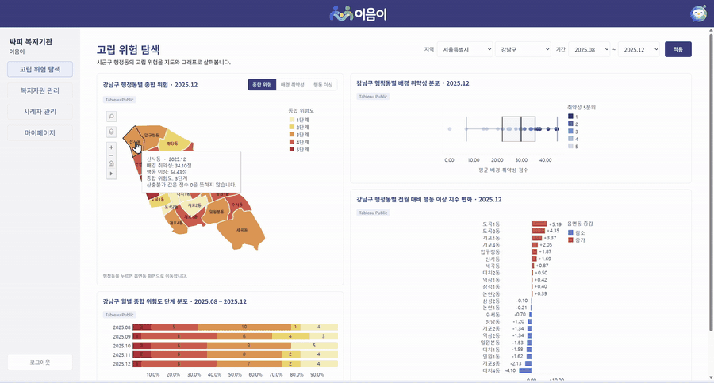
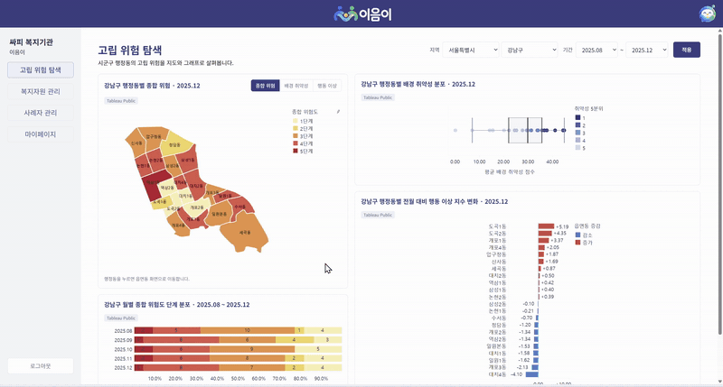
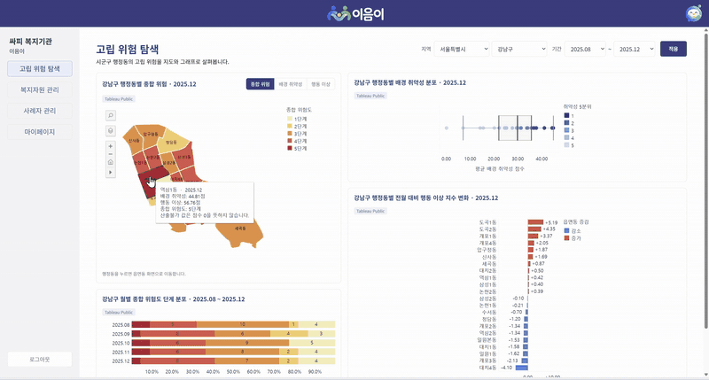
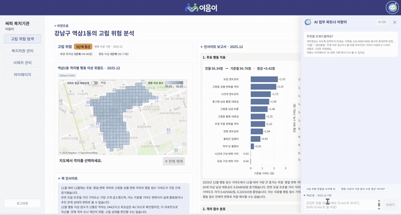
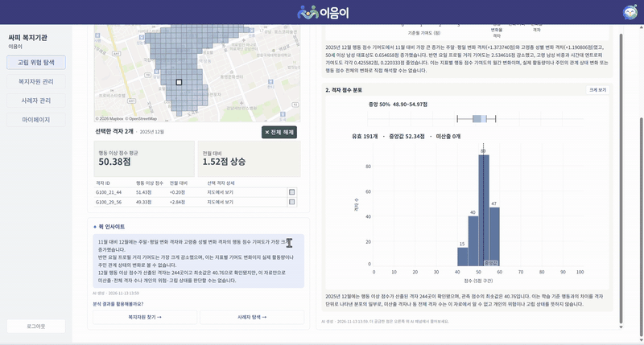
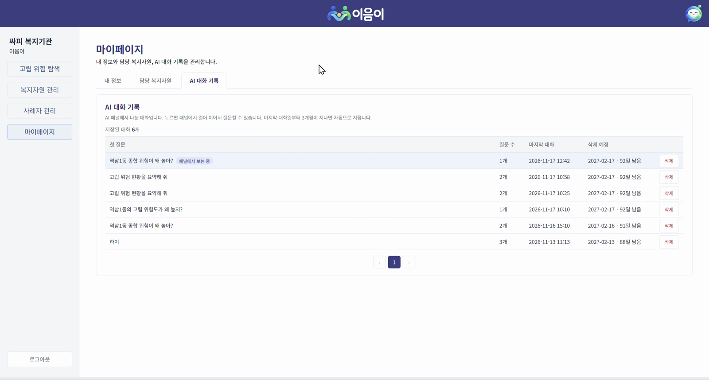
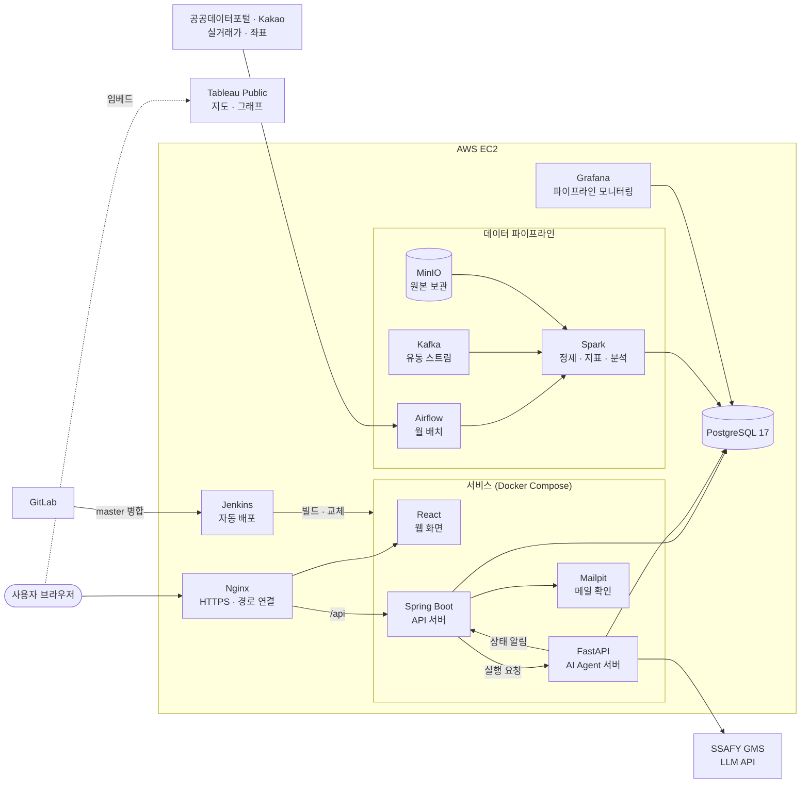
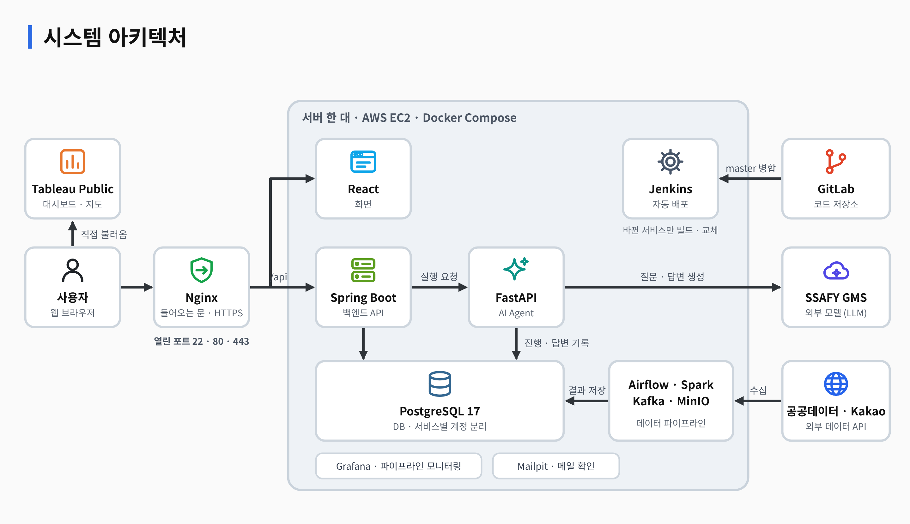
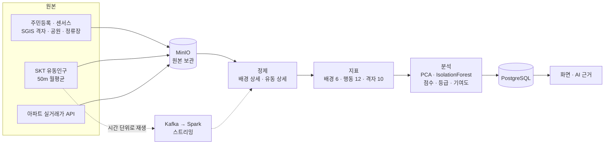

# 이음이 (Eumi)

> 지역의 사회적 고립 위험 신호를 데이터로 찾고, AI 에이전트와 함께 근거를 확인해 복지 담당자가 방문 지역과 우선순위를 정하도록 돕는 웹 서비스

- **서비스 주소**: https://k15b201.p.ssafy.io (기관 계정으로 로그인, 시연용 데이터)
- **개발 기간**: 2026.10.26 ~ 2026.11.18
- **분석 지역**: 서울 강남구 · 강원 춘천시 47개 읍면동 (2025년 8 ~ 12월)
- **SSAFY 15기 자율 프로젝트** (B201)

<!-- 대표 GIF: 로그인 → 고립 위험 탐색 → 읍면동 상세 → AI 질문 (15초 안팎). 파일을 넣은 뒤 아래 주석을 풀어 주세요.
<p align="center"></p>
-->

## 목차

1. [프로젝트 소개](#프로젝트-소개)
2. [주요 기능](#주요-기능)
3. [시스템 아키텍처](#시스템-아키텍처)
4. [데이터 분석 흐름](#데이터-분석-흐름)
5. [기술 스택](#기술-스택)
6. [기술적 도전과 해결](#기술적-도전과-해결)
7. [검증 결과](#검증-결과)
8. [팀 소개](#팀-소개)
9. [문서](#문서)
10. [개발 환경과 협업 규칙](#개발-환경과-협업-규칙)

## 프로젝트 소개

사회적으로 고립된 가구는 먼저 도움을 요청하지 않는 경우가 많아, 복지 담당자가 신고나 방문만으로 찾아내기 어렵습니다.

이음이는 인구 · 주택 통계와 통신사 유동인구 데이터로 지역의 고립 위험 신호를 계산해 지도로 보여 주고, AI 에이전트가 그 결과를 근거와 함께 설명합니다. 담당자는 위험 지역을 확인한 뒤 같은 서비스에서 사례자와 복지자원을 관리할 수 있습니다.

**대상 사용자**: 복지기관 담당자 (소속 기관의 관할 시군구 기준으로 이용)

### 위험을 보는 두 가지 지수

| 지수 | 무엇을 보나 | 데이터 | 계산 |
|---|---|---|---|
| 배경 취약성 | 고립이 생기기 쉬운 지역 여건 | 주민등록 · 센서스 · 공원 · 버스정류장 → 지표 6개 | PCA 기반 점수 → 1 ~ 3등급 |
| 행동 이상 | 평소와 다른 생활 활동 | SKT 유동인구 → 읍면동 지표 12개 · 100m 격자 지표 10개 | 도시별 IsolationForest → 1 ~ 3등급 |
| **종합 위험 단계** | 두 지수를 합친 우선순위 | 위 두 등급 | 두 등급의 합 − 1 → 1 ~ 5단계 (5 = 최우선) |

## 주요 기능

### 1. 고립 위험 탐색

관할 시군구의 행정동별 위험을 지도와 그래프로 한눈에 봅니다.

<!-- GIF: 지수 바꾸기 · 기간 바꾸기 · 지도에서 동 고르기
<p align="center"></p>
-->

- 행정동별 지도에서 종합 위험 · 배경 취약성 · 행동 이상 중 하나를 골라 봅니다.
- 월별 종합 위험 단계 분포, 배경 취약성 분포, 전월 대비 행동 이상 변화를 함께 보여 줍니다.
- 지수를 바꾸면 지도가 1초 안에 다시 그려집니다.

### 2. 읍면동 상세 · AI 인사이트 보고서

동을 고르면 100m 격자 단위로 내려가 위험이 몰린 곳을 확인하고, AI가 정리한 보고서를 함께 봅니다.

<!-- GIF: 동 상세 진입 → 격자 지도 → 퀵 인사이트 → 보고서 그래프 크게 보기
<p align="center"></p>
-->

- 격자별 행동 이상 지도로 동 안에서도 평소와 다른 구역을 찾습니다.
- 퀵 인사이트와 인사이트 보고서(그래프 최대 3개 · 그래프별 설명)는 AI가 분석 결과를 조회해 작성하고, 검토를 통과한 내용만 보여 줍니다.
- 자주 보는 동은 미리 띄워 두고, 다른 메뉴에 다녀와도 보던 화면을 그대로 유지합니다.

### 3. AI Agent 패널

어느 화면에서든 자연어로 질문하면, AI 에이전트가 분석 결과를 직접 조회해 답합니다.

<!-- GIF: 질문 입력 → 진행 단계 표시 → 답변 · 표 · Tableau 그래프
<p align="center"></p>
-->

- 보고 있는 화면 정보를 질문과 함께 보내, 지금 보는 동 · 기간에 맞춰 답합니다.
- 요청 처리 Agent가 해석 Agent · 시각화 Agent에 일을 나누고, 각 Agent가 자료 조회 · 계산 · 그래프 검증 도구를 골라 실행합니다.
- 진행 단계를 실시간으로 보여 주고, 중간에 취소할 수 있습니다.
- 대화 기록은 마이페이지에서 다시 보거나 지울 수 있고, 3개월이 지나면 자동으로 지워집니다.
- 질문 속 이메일 · 휴대전화 · 이름 항목은 가린 뒤 AI에 전달합니다.

### 4. 사례자 · 복지자원 관리

위험 지역을 확인한 뒤 실제 업무로 이어 갑니다.

<!-- GIF: 사례자 등록 → 상담 기록 추가 / 복지자원 검색
<p align="center"></p>
-->

- 사례자를 등록하고 담당자를 지정해 상담 기록을 남깁니다. 사례자 정보는 담당자만 볼 수 있습니다.
- 기관이 운영하는 복지자원을 등록하고 검색 · 정렬합니다. 조회는 모든 기관이, 수정 · 삭제는 담당자만 할 수 있습니다.

### 5. 기관 인증 회원 · 마이페이지

<!-- 이미지: 가입 화면(기관 검색 · 이메일 인증) 또는 마이페이지
<p align="center"></p>
-->

- 소속 기관을 검색하고, 기관 공식 이메일 도메인으로 인증해 가입합니다.
- 비밀번호 찾기(임시 비밀번호), 비밀번호 변경, 내 정보 · 내 복지자원 · AI 대화 기록을 관리합니다.
- 탈퇴할 때는 담당하던 사례자와 진행 중인 복지자원을 다른 회원에게 넘깁니다.

## 시스템 아키텍처



<!-- 아키텍처를 그림 파일로 바꾸려면 위 Mermaid 대신:
<p align="center"></p>
-->

- 한 서버에서 서비스 · DB · 데이터 파이프라인을 Docker Compose로 운영하고, Nginx가 HTTPS와 경로 연결을 맡습니다.
- AI 서버는 백엔드의 요청을 받아 진행 단계와 답변을 DB에 직접 기록하고, 화면은 백엔드를 통해 새 기록을 조회합니다.
- DB 계정을 서비스마다 나눠, AI는 분석 결과만 읽고 회원 · 사례자 표에는 접근하지 못합니다.

## 데이터 분석 흐름



- **월 배치**: Airflow가 수집 → 정제 → 지표 → 분석 → 결과 검증을 차례로 실행합니다. 단계마다 검사해 실패하면 다음 단계로 넘어가지 않습니다.
- **스트리밍**: SKT 월평균에 맞춰 만든 시간 단위 유동을 Kafka로 재생하고, Spark Structured Streaming이 1시간 워터마크 · 하루 윈도로 집계해 유동 상세에 더합니다.
- **모니터링**: 검증 결과와 스트리밍 진행 기록은 Grafana 대시보드로 봅니다.

## 기술 스택

| 구분 | 기술 |
|---|---|
| 프론트엔드 | React 19.3 · TypeScript 5.9 · Vite 8.3 · React Router 7.18 · TanStack Query 5 · Tailwind CSS 4.3 · Tableau Embedding API v3 |
| 백엔드 | Java 21 · Spring Boot 4.1.2 · Spring Security · Spring Session JDBC · Spring Data JPA · Gradle 9.8 |
| AI | Python 3.12 · FastAPI 0.162 · LangGraph 1.2 · LangChain Core 1.7 · SSAFY GMS (gpt-6-luna) |
| 데이터 | Spark 3.5.9 (PySpark) · Kafka 3.9.2 (KRaft) · Airflow 2.10.5 · MinIO · scikit-learn 1.8 |
| DB | PostgreSQL 17 · Flyway 13.11 |
| 인프라 · 운영 | AWS EC2 · Docker · Docker Compose · Jenkins · Nginx · Let's Encrypt · Grafana 12.4 · Mailpit |
| 협업 | GitLab · Jira · Mattermost · Figma |

## 기술적 도전과 해결

### AI 진행 상황을 화면에 전달하기

- **문제**: 처음에는 백엔드가 SSE로 AI 진행 상황을 중계하기로 했습니다. 그러려면 백엔드가 실행 상태를 메모리에 들고, Nginx에도 SSE 설정을 따로 해야 했습니다.
- **해결**: AI가 진행 단계와 답변을 DB에 한 행씩 직접 기록하고, 화면은 1초마다 새 행만 조회하도록 바꿨습니다. 실행 시간 한도 · 취소 · 응답 없음 감지는 백엔드가 맡습니다.
- **결과**: 동시 20명 성능 평가에서 질문 후 첫 진행 안내가 1.1초 안팎, AI 저장 → 화면 표시가 p95 0.99초였습니다. ([결정 기록](docs/decisions/login-sse.md))

### AI가 그래프를 지어내지 않게 하기

- **문제**: 언어 모델이 그래프를 직접 만들면 실제 분석 결과와 다른 그림이 나올 수 있습니다.
- **해결**: 시각화 Agent는 미리 등록한 Tableau 뷰와 파라미터만 고르고, 검증 도구로 확인한 뒤 씁니다. 보고서는 작성 → 검토를 거쳐 통과한 칸만 저장해, 시간 한도 안에 일부만 완성돼도 버리지 않습니다.
- **결과**: 답변과 보고서의 그래프는 화면과 같은 Tableau 뷰로만 구성됩니다. ([AI 패널 동작](docs/api/ai-agent-panel.md) · [인사이트 보고서](docs/api/insight-report.md))

### Tableau 대시보드 로딩

- **문제**: Tableau 임베드는 그래프마다 세션을 새로 열어 첫 표시까지 3 ~ 5초가 걸리고, 다른 메뉴에 다녀오면 처음부터 다시 불러왔습니다.
- **해결**: 위험 탐색 화면을 지우지 않고 숨겨 두는 구조로 바꾸고, 자주 보는 동을 미리 띄워 둡니다.
- **결과**: 다른 메뉴에서 돌아오거나 미리 띄운 동에 들어갈 때 0.03초 안팎에 바로 쓸 수 있습니다. ([성능 평가](docs/perf/README.md))

### 이상 탐지 결과의 이유 설명

- **문제**: IsolationForest는 이상 점수만 주고, 어떤 지표 때문에 점수가 높은지는 알려 주지 않습니다.
- **해결**: 지표 하나만 같은 도시 · 같은 달 동들의 중앙값으로 바꿔 점수를 다시 계산하고, 원래 점수와의 차이를 그 지표의 기여도로 정했습니다(지표 치환).
- **결과**: 동 · 달마다 행동 지표 12개의 기여도를 저장해 AI 답변과 보고서의 근거로 씁니다. ([데이터 파이프라인](data/README.md))

### 바뀐 서비스만 배포하고 실패하면 되돌리기

- **문제**: 한 서버에 서비스 · DB · 데이터 파이프라인이 함께 있어, 매번 전체를 다시 띄우면 느리고 위험합니다.
- **해결**: master에 병합되면 Jenkins가 바뀐 서비스만 이미지로 빌드하고, DB 백업 → Flyway 마이그레이션 → 서비스 교체 · 헬스체크 순서로 배포합니다. 헬스체크가 실패하면 이전 이미지로 되돌립니다.
- **결과**: 문서만 바뀐 병합은 서비스를 다시 띄우지 않고, 배포에 실패해도 이전 버전이 유지됩니다. 운영 비밀값은 서버에만 둡니다. ([인프라](infra/README.md))

## 검증 결과

운영 서버에서 측정했습니다. 자세한 조건과 수치는 [성능 평가](docs/perf/README.md)에 있습니다.

| 구분 | 방법 | 결과 |
|---|---|---|
| 성능 (11/10 · 11/13) | Playwright 화면 흐름 + k6 동시 20명 | 목표 12개 중 10개 충족. API 오류율 0%, 가장 느린 API p95 106ms, 화면 표시 p95 0.45초 |
| 〃 미충족 | | 동시 20명일 때 격자 지도 중앙값 5.2초(목표 5초), AI 질문 13건 중 2건 실패(LLM API 일시 오류) |
| 보안 (11/11 · 11/12) | 비로그인 외부 점검, 로그인 기반 권한 · 세션 · CSRF · XSS 점검 | 모두 통과, HSTS 추가 |
| AI 회귀 테스트 | pytest | 146개 통과 |

## 팀 소개

| 이름 | 역할 | 담당 |
|---|---|---|
| 김민준 | PM · AI | 일정 · Jira 관리, AI Agent 서버 (멀티 에이전트 · 인사이트 보고서) |
| 김민재 | BE · FE · Infra | API 서버, 웹 화면, DB 설계, 배포 · 운영 환경 |
| 강병민 | 데이터 엔지니어링 | 수집 · 적재 파이프라인 (Spark · Kafka · Airflow) |
| 이지석 | 데이터 분석 | 지표 설계, 이상 탐지 모델, Tableau 대시보드 |
| 배유진 · 이지원 | 기획 참여 | 기획 단계 참여 |

## 문서

| 문서 | 위치 |
|---|---|
| 기능명세 · API 명세 · 테이블 정의서 (md 원본 + 엑셀) | [docs/spec/](docs/spec/README.md) |
| API 계약 (OpenAPI) · 공통 규칙 · AI 패널 · 인사이트 보고서 | [docs/api/](docs/api/README.md) |
| 결정 기록: 로그인 방식 · AI 흐름 전달, 내부 연동 | [docs/decisions/](docs/decisions/login-sse.md) |
| 성능 평가 계획 · 결과 | [docs/perf/](docs/perf/README.md) |
| AI 설계 · 개발 | [ai/docs/](ai/docs/README.md) |
| 데이터 파이프라인 | [data/](data/README.md) |
| DB 스키마 · 마이그레이션 규칙 | [db/](db/README.md) |
| 로컬 개발 환경 · 운영 배포 | [infra/](infra/README.md) |
| 문서 전체 목록 | [docs/README.md](docs/README.md) |

## 개발 환경과 협업 규칙

<details>
<summary>로컬에서 실행하기</summary>

### 준비물

| 파트 | 필요한 것 |
|---|---|
| 공통 | Git, Docker Desktop (설치 + 실행) |
| BE | JDK 21 |
| FE | Node 24 |
| AI | Python 3.12 또는 3.13, uv |
| 데이터 | 데이터 파트가 정한 Python 환경 |

### 받기와 로컬 DB

```bash
git clone https://lab.ssafy.com/s15-final/S15P31B201.git
cd S15P31B201                    # 기본 브랜치 develop

cd infra
cp .env.example .env
docker compose up -d             # PostgreSQL 17 + 스키마 · 계정 · 권한 + 메일 확인용 Mailpit
```

DB 계정, 메일 확인, 문제 해결은 [infra/README.md](infra/README.md)를 봅니다.

### 파트별 실행

| 구분 | 실행 | 확인 |
|---|---|---|
| 백엔드 | `cd backend` → `./gradlew bootRun` (또는 IntelliJ) | http://localhost:8080/api/health |
| 프론트엔드 | `cd frontend` → `nvm use 24` → `npm ci` → `npm run dev` | http://localhost:5173 |
| AI Agent 서버 | [ai/](ai/README.md) | |
| 데이터 파이프라인 | [data/](data/README.md) | |

</details>

<details>
<summary>디렉터리 구조</summary>

```
.
├── frontend/          # React 웹 (Vite)
├── backend/           # Spring Boot API 서버
├── ai/                # FastAPI AI Agent 서버
│   └── docs/          #   AI 설계·개발 문서
├── data/              # 데이터 수집 · 적재 · 분석
│   ├── airflow/       #   Airflow DAG (월 배치)
│   ├── pipeline/      #   수집 · 정제 · 지표 · 분석 · 운영 스크립트
│   ├── notebooks/     #   탐색 · 분석 노트북
│   └── demo_seed/     #   시연용 복지자원 · 사례자 데이터 생성
├── db/                # PostgreSQL 스키마 (여러 서버가 같은 DB를 쓰므로 한 곳에서 관리)
│   ├── migration/     #   Flyway 마이그레이션 + 계정별 권한(afterMigrate.sql)
│   ├── roles/         #   DB 계정 생성 SQL
│   └── seed/          #   개발 · 시연용 초기 데이터
├── infra/             # 로컬 개발 환경, 운영 배포(deploy) · 배포 스크립트 · 파이프라인 이미지 · Grafana
├── docs/              # 명세 · API 계약 · 결정 기록 · 성능 평가
├── .gitlab/           # MR 템플릿
├── Jenkinsfile        # CI/CD
├── CONTRIBUTING.md    # 협업 규칙 (브랜치 · 커밋 · MR · 리뷰 · Jira · DB · 비밀값)
└── README.md
```

</details>

<details>
<summary>협업 규칙 요약</summary>

전체 내용은 [CONTRIBUTING.md](CONTRIBUTING.md)를 봅니다.

- **브랜치**: `master`(배포) · `develop`(기본, 개발 통합)은 직접 push가 막혀 있습니다. `develop`에서 `태그/기능명` 브랜치를 만들어 `develop` 대상 MR로 병합합니다.
- **커밋**: 제목 `{태그}: [{기능명}] 한 일`, 한 줄 띄우고 `Jira: 이슈 키`
- **MR 리뷰**: DB 마이그레이션, 파트 간 API · 이벤트 형식, `infra/`는 리뷰어 승인 후 병합합니다. 그 밖에는 리뷰어만 지정하고 병합할 수 있습니다.
- **Jira**: 작업 전에 Task를 만들고, 키를 커밋 본문과 MR 설명에 적습니다.
- **DB**: 병합된 마이그레이션 파일은 고치지 않고 새 파일로 추가합니다. 테이블 변경은 'Eumi ERD 변경 기록'에 먼저 적습니다.
- **비밀값**: `.env` · 키 파일은 커밋하지 않고, 전달은 Mattermost 비공개 채널에서만 합니다. 로컬 DB에는 가짜 데이터만 넣습니다.

</details>
