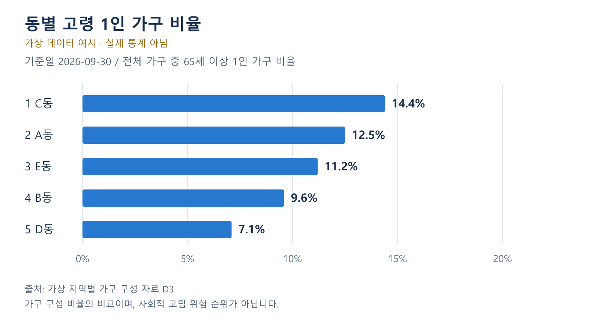

# AI 에이전트 실행 시나리오

수정일: 2026-11-12.

실행 예시·시연 문구·산출물을 장면별로 정리한다. 아래 순서는 예상 흐름이며 고정된 절차가 아니다. 실제 실행은 공통 실행 흐름을 따르고 상황에 따라 단계를 추가하거나 생략한다. 현재 서비스의 보고서 생성 범위는 [보고서 생성](report.md), 게시된 뷰의 선택·검증 범위는 [Tableau 시각화](tableau.md)를 따른다. 아래 가상 차트 생성 예시는 현재 서비스의 지원 범위를 뜻하지 않는다.

지역·수치·날짜·출처와 아래 장면별 안내 문구는 시연용 예시다. 현재 사용자 요청 API는 노드 시작 때 정해진 단계 이름을 저장·알림하며, 모델이 아래 상세 안내 문구를 생성하지 않는다. 실제 진행 안내와 화면 표시 범위는 [실행 흐름](workflow.md#21-사용자-요청의-진행-안내와-결과-전달)을 따른다. 모든 시연 화면에 ‘시연용 예시 데이터’를 표시한다.

## 1. 장면 구성

| 식별자 | 장면 | 시작 | 담당 에이전트 | 산출물 |
| --- | --- | --- | --- | --- |
| S1 | 기본 분석 해석 | 분석 완료 이벤트 | 데이터 분석 결과 해석 에이전트 | 해석문·비교표·근거 |
| S2 | 동별 비율 시각화 | 자연어 요청 | 사용자 요청 처리 에이전트, 데이터 시각화 에이전트 | 차트·사용 데이터·표현 설정 |
| S3 | 선택 차트 설명 | 자연어 후속 요청 | 사용자 요청 처리 에이전트 | 통합 답변·기존 차트·근거 |

자연어 요청은 같은 대화창에서 받는다. 자동 실행에 가짜 사용자 발화를 넣지 않는다. 현재 서비스 화면은 단계 시작 안내를 표시하고, 답변·산출물은 완료 행에서 표시한다. 개별 작업의 새 산출물을 실행 중에 먼저 표시하지 않는다.

## 2. S1 기본 분석 해석

### 2.1 입력과 처리

사전 조건: 조회할 분석 결과와 D1·D2가 등록되어 있다. 시스템은 분석 완료 이벤트로 goal에 목적·분석 대상·기간을 서술하고 constraints와 시스템 지침 messages를 구성한다. 실제 자료 버전은 조회 결과에서 확보한다. 분석 완료 이벤트 후 해석을 생성하고, [API의 보고서 생성 계약](../runtime/api.md#2-보고서-생성)의 조건에 따라 게시하면 담당자는 A동 분석 화면에서 확인한다.

| 순서 | 처리 | 화면 상태 | 안내 문구·표시 내용 |
| --- | --- | --- | --- |
| 1 | 이벤트 입력 검증 후 작업 진행 판단에서 분석 결과·지표 정의·비교 기준·실제 버전이 필요함을 기록. 작업 선택 및 실행에서 그 판단에 따른 조회 수행. 도구 입력 검사와 호출 결과 기록 | 분석 자료 확인 중 | 분석 결과와 지표 정의를 확인하고 있어요. |
| 2 | 작업 진행 판단에서 부족한 비교 정보·이유 기록. 작업 선택 및 실행에서 구체적인 조회·가공 선택, 실행·결과 기록·필요한 재시도 | 비교 자료 확인 중 | 인접 지역과 전년도 같은 기간을 비교하고 있어요. |
| 3 | 작업 진행 판단에서 작성 가능 여부 기록 후 응답 작성에서 주요 신호·비교 설명·근거·한계와 비교표를 공개 응답으로 구성 | 해석 작성 중 | 확보한 비교 결과를 바탕으로 변화와 한계를 설명하고 있어요. |
| 4 | 해석 결과를 게시 담당에 전달. 게시 조건에 따라 저장·게시 | 분석 해석 준비 완료 | 아래 해석·비교표·출처 표시 |

해석할 자료가 없으면 사유를 반환하고 일부만 설명할 수 있으면 범위를 표시한다. 자연어 요청으로 실행한 해석은 호출자에게 반환하며 대시보드 해석을 자동 교체하지 않는다. 이미 게시된 해석은 바로 표시하고, 화면 진입만으로 분석을 실행하거나 로딩을 다시 연출하지 않는다.

### 2.2 산출물: A동 활동지수 감소 해석

A동의 2026년 9월 활동지수는 108로, 8월의 120보다 10.0% 감소했습니다. 인접 지역과 전년도 같은 기간에도 감소가 나타나, 이 변화만으로 A동의 사회적 고립 위험이 증가했다고 단정하기는 어렵습니다.

**지표의 의미**

각 동의 2025년 1월 관측 활동량을 100으로 환산한 지수입니다. A동의 108은 A동 기준 시점보다 8% 높은 수준입니다. 고립 위험 점수가 아니며, 서로 다른 동의 지수 수준을 활동량의 절대 크기로 비교하지 않습니다.

**비교 근거**

| 지역 | 2026년 8월 | 2026년 9월 | 2026년 변화율 | 2025년 8월 | 2025년 9월 | 2025년 변화율 |
| --- | ---: | ---: | ---: | ---: | ---: | ---: |
| A동 | 120 | 108 | -10.0% | 110 | 99 | -10.0% |
| B동 | 100 | 92 | -8.0% | 100 | 92 | -8.0% |
| C동 | 80 | 72 | -10.0% | 90 | 81 | -10.0% |

변화율은 각 연도의 `(9월 지수 - 8월 지수) ÷ 8월 지수 × 100`입니다. 전년 동월 대비 변화율과 구분합니다.

**해석 한계**

현재 비교 결과는 A동에만 나타난 변화라는 설명을 뒷받침하지 않습니다. 계절적 변화나 여러 지역에 함께 작용한 요인도 가능한 설명입니다. 한 해의 비교로 계절성이 원인이라고 확정할 수 없습니다. 해석은 관측된 지역·집단 단위의 변화에 한정합니다.

출처: 가상 자료 D1·D2. 같은 정의·집계 기준으로 비교할 수 있다는 예시 조건을 적용했습니다.

### 2.3 노드별 State 반영 예시

아래는 해석 역할을 단독 실행했을 때 노드 처리가 끝난 시점의 기록이다. 단독 실행에는 사용자 요청 API의 진행 안내·저장 콜백이 없으므로 응답 작성 전에는 `response`를 유지한다. 데이터·버전 값은 시연용이며 실제 호출 결과에서 확보한다.

| 위치 | 요청 (`request`) | 메시지 (`messages`) | 작업 이력 (`results`) | 공개 응답 (`response`) | 실행 정보 (`execution`) |
| --- | --- | --- | --- | --- | --- |
| 이벤트 초기화 | 목적·분석 ID·A동·2026년 9월을 goal에 서술, 조건 설정 | 시스템 지침 | [] | null | queued, 배포 version, 사용량 0 |
| 작업 진행 판단: 기본 자료 필요 | 유지 | 유지 | 필요한 분석 결과·지표 정의·비교 기준을 reason에 적고 output.next를 act로 기록 | 유지 | running |
| 작업 선택 및 실행: 기본 조회 | 유지 | 유지 | 선택 이유, A동 120→108·지표 정의·출처·실제 버전의 output, 도구 검사 결과 | 유지 | running, 호출 사용량 증가 |
| 작업 진행 판단: 비교 부족 | 유지 | 유지 | 인접 지역·전년도 비교 자료가 필요하다는 reason과 output.next=act 추가 | 유지 | running |
| 작업 선택 및 실행: 비교·계산 | 유지 | 유지 | B·C동·전년도 조회, A -10%·B -8%·C -10% 계산, 도구 검사·재시도 기록 | 유지 | running, 호출 사용량 증가 |
| 작업 진행 판단: 작성 가능 | 유지 | 유지 | 확보한 근거로 설명 가능하다는 reason과 output.next=compose 추가 | 유지 | running |
| 응답 작성 | 유지 | 유지 | 해석·비교표 작성 이력 | final, 해석·출처·한계는 content, 비교표는 artifacts | 반환·종료 시 completed |
| 게시 담당 | 유지 | 유지 | 에이전트 내부 이력 유지 | 생성 응답 유지 | completed 유지. 게시 성공과 구분 |

내부 이력 전체를 공개하지 않고 공개 응답만 화면에 제공한다. 공통 필드와 노드별 쓰기 책임은 [State](state.md)를 따른다.

## 3. S2 동별 비율 시각화

### 3.1 입력과 처리

사전 조건: 화면의 비교 범위는 A~E동이며 D3의 지표 정의·기준일이 등록되어 있다.

사용자 입력: “2026년 9월 말 기준으로 동별 고령 1인 가구 비율을 높은 순서대로 그래프로 보여줘.”

시연용 안내 예시: “선택된 5개 동의 고령 1인 가구 비율을 확인해 높은 순서대로 보여드리겠습니다.”

| 순서 | 처리 | 화면 상태 | 안내 문구·표시 내용 |
| --- | --- | --- | --- |
| 1 | 작업 목적 파악 후 작업 진행 판단에서 필요한 데이터·단위·기간·비교 기준을 정하고 작업 선택 및 실행에서 조회 | 데이터 조회 중 | 같은 기준일의 동별 가구 자료를 확인하고 있어요. |
| 2 | 작업 진행 판단에서 필요한 비율·정렬 결과가 부족함을 기록. 작업 선택 및 실행에서 계산·정렬 도구 선택·호출·결과 기록 | 비율 계산·정렬 중 | 전체 가구 중 고령 1인 가구 비율을 계산하고 있어요. |
| 3 | 작업 진행 판단이 시각화 산출물이 필요함을 기록하고 작업 선택 및 실행에서 표현 설정을 정해 렌더링 도구 호출. 도구의 입력·표현 조건 검사 결과를 기록하고 필요한 보완 수행 | 그래프 생성 중 | 비율을 비교할 가로 막대그래프를 만들고 있어요. |
| 4 | 작업 진행 판단에서 실제 시각화와 요청한 정렬·표현·출처가 확보됐는지 확인하고 보완 필요 여부 결정 | 그래프 확인 중 | 요청한 비교를 보여줄 준비가 됐는지 확인하고 있어요. |
| 5 | 응답 작성에서 시각화·사용 자료·설정·주의사항 구성. 요청 처리 에이전트가 공개 응답을 작성하고 서버 전달 후 프론트가 표시 | 시각화 완료 | 아래 차트·데이터·설정 표시 |

원자료와 다르면 데이터·표현 설정을 보완하고 다시 렌더링한다. 명세만 생성한 상태는 완료로 처리하지 않으며 결측을 0으로 표시하지 않는다.

### 3.2 산출물: 동별 고령 1인 가구 비율

최종 응답: “C동 14.4%, A동 12.5%, E동 11.2%, B동 9.6%, D동 7.1% 순입니다. 가구 구성 비율의 순위이며 고립 위험 순위는 아닙니다.”

기준일: 2026-09-30. 전체 가구 중 65세 이상 1인 가구가 차지하는 비율입니다.

그림 원본: [동별 비율 차트](../assets/agent-output-examples/elderly-single-households.png). 데이터: [시연용 자료](../assets/agent-output-examples/visualization-data.json).

| 순위 | 지역 | 65세 이상 1인 가구 수 | 전체 가구 수 | 비율 |
| --- | --- | ---: | ---: | ---: |
| 1 | C동 | 1,728 | 12,000 | 14.4% |
| 2 | A동 | 1,250 | 10,000 | 12.5% |
| 3 | E동 | 1,232 | 11,000 | 11.2% |
| 4 | B동 | 768 | 8,000 | 9.6% |
| 5 | D동 | 639 | 9,000 | 7.1% |

계산식: `65세 이상 1인 가구 수 ÷ 전체 가구 수 × 100`. 고령자 가구만을 분모로 사용하지 않습니다. 이 순위는 가구 구성 비율이며 사회적 고립 위험 순위가 아닙니다.

| 설정 | 내용 |
| --- | --- |
| 표현 | 가로 막대그래프 |
| 정렬 | 비율 내림차순 |
| 가로축 | 0~20% |
| 세로축 | 지역명 5개 |
| 수치 | 소수점 첫째 자리 표시 |
| 색상 | 동일 파란색. 위험 등급을 나타내지 않음 |
| 자료 | 가상 자료 D3. 원본은 그림 아래의 시연용 자료 참조 |

5개 동 모두 같은 기준일·지표 정의를 사용하며 결측값은 없습니다.

## 4. S3 선택 차트 설명

### 4.1 입력과 처리

사전 조건: S2의 차트·D3·기준일을 선택 대상으로 유지한다.

사용자 입력: “이 그래프에서 A동은 어떻게 읽으면 돼? 고립 위험이 두 번째로 높다는 뜻이야?”

| 순서 | 처리 | 화면 상태 | 안내 문구·표시 내용 |
| --- | --- | --- | --- |
| 1 | 작업 목적 파악에서 현재 화면·선택 차트·관련 이력으로 대상 특정 | 선택한 그래프 확인 중 | 현재 그래프의 자료와 지표 정의를 확인하고 있어요. |
| 2 | 작업 진행 판단에서 S2의 차트·자료·지표 정의로 설명 가능함을 확인하고 응답 작성 선택 | 설명 근거 확인 중 | 기존 차트의 자료와 지표 정의로 설명할 수 있어요. |
| 3 | 응답 작성에서 비율의 의미·해석 범위와 기존 차트·근거 통합 | 설명 완료 | 아래 통합 답변과 S2 차트·근거 연결 |

### 4.2 산출물: 통합 답변

> A동은 전체 10,000가구 중 65세 이상 1인 가구가 1,250가구로, 비율은 12.5%입니다. 표시된 5개 동 중 두 번째로 높습니다.
>
> 이 순위는 가구 구성 비율입니다. 사회적 고립 위험이 두 번째로 높다는 뜻은 아닙니다. 방문 지역을 판단하려면 다른 분석 지표와 현장 정보를 함께 검토해야 합니다.

통합 응답에는 S2의 선택 차트·사용 데이터·근거를 연결한다. 설명에 필요한 자료가 충분하므로 작업 선택 및 실행을 거치지 않고 기존 차트를 유지한다. S1의 활동지수와 S2의 가구 비율은 서로 다른 지표이며 같은 값처럼 설명하지 않는다.

### 4.3 요청별 도구·에이전트 호출

| 요청 | 선택할 작업 |
| --- | --- |
| “이 지표가 줄어든 이유를 설명해줘.” | 해석 에이전트로 관측 변화·비교 근거·설명 가능한 범위 확인 |
| “동별 고령 1인 가구 비율을 그래프로 보여줘.” | 시각화 에이전트로 조회·정렬·렌더링 후 결과 제공 |
| “A동 활동지수의 변화를 그래프로 보여주고 설명해줘.” | 같은 자료·버전으로 시각화와 해석을 요청하고 통합 |

현재 화면·선택 대상·관련 이력으로 요청을 특정한다. 확인할 수 있는 정보를 반복해서 묻지 않는다. 대상이 모호하거나 사용자만 제공할 수 있는 핵심 정보가 부족하면 질문한다. 범위 밖 요청은 지원 범위를 안내한다.

## 5. 예외 표시

| 상황 | 화면 문구 | 처리 |
| --- | --- | --- |
| 대상 모호 | “어떤 지역과 기간을 비교할까요?” | 되묻기를 DB 완료 행으로 저장하고 이번 요청 종료. 다음 답변은 대화 기록을 읽는 새 State·새 예산으로 실행 |
| 자료 없음 | “현재 조회 범위에 해당 자료가 없습니다.” | 조회 범위와 미확인 사항 표시 |
| 조회 실패 | “자료를 불러오지 못했습니다.” | 자료 없음과 구분 |
| 지표 정의 누락 | “지표 뜻을 확인할 자료가 필요합니다.” | 설명 가능한 범위만 제공 |
| 차트 불일치 | “그래프의 표시값을 수정하고 있습니다.” | 작업 선택 및 실행에서 불일치 검증·보완 이력 기록. 작업 진행 판단 후 응답 작성에서 해당 차트를 교체·제외 |
| 취소 | “요청을 중단했습니다.” | 후속 실행 중단 |

## 6. 가상 자료

| 식별자 | 자료 | 내용 |
| --- | --- | --- |
| D1 | 월간 활동지수 비교 자료 | 2025·2026년 8·9월 A·B·C동의 관측 지수 |
| D2 | 월간 활동지수 정의서 | 각 동의 2025년 1월을 100으로 둔 기준과 비교 범위 |
| D3 | 지역별 가구 구성 자료 | 2026-09-30 A~E동 전체 가구·65세 이상 1인 가구 수 |

D1~D3은 실제 기관 URL이나 검증된 출처를 대신하지 않는다. 이 문서는 시연 콘텐츠이며 영상 촬영이나 실제 데이터 연동 완료를 뜻하지 않는다.

## 7. S2·S3의 기록·공개 적용

S2의 조회·비율 계산·정렬·렌더링 결과와 도구의 부적합 판정은 results에 기록한다. 실제 시각화가 준비되면 응답 작성에서 차트·사용 데이터·설정은 response.artifacts에, 설명·출처·한계는 content 또는 해당 산출물에 포함한다.

S3는 관련 대화와 선택 차트를 읽어 goal·constraints를 구체화한다. 쓰기 범위가 읽기 범위를 제한하는 것은 아니다. 기존 자료로 설명 가능하다는 진행 판단을 results에 남기고, 응답 작성에서 기존 S2 차트를 유지한 response를 구성한다. 내부 sources·issues·result_refs 필드는 추가하지 않는다.
