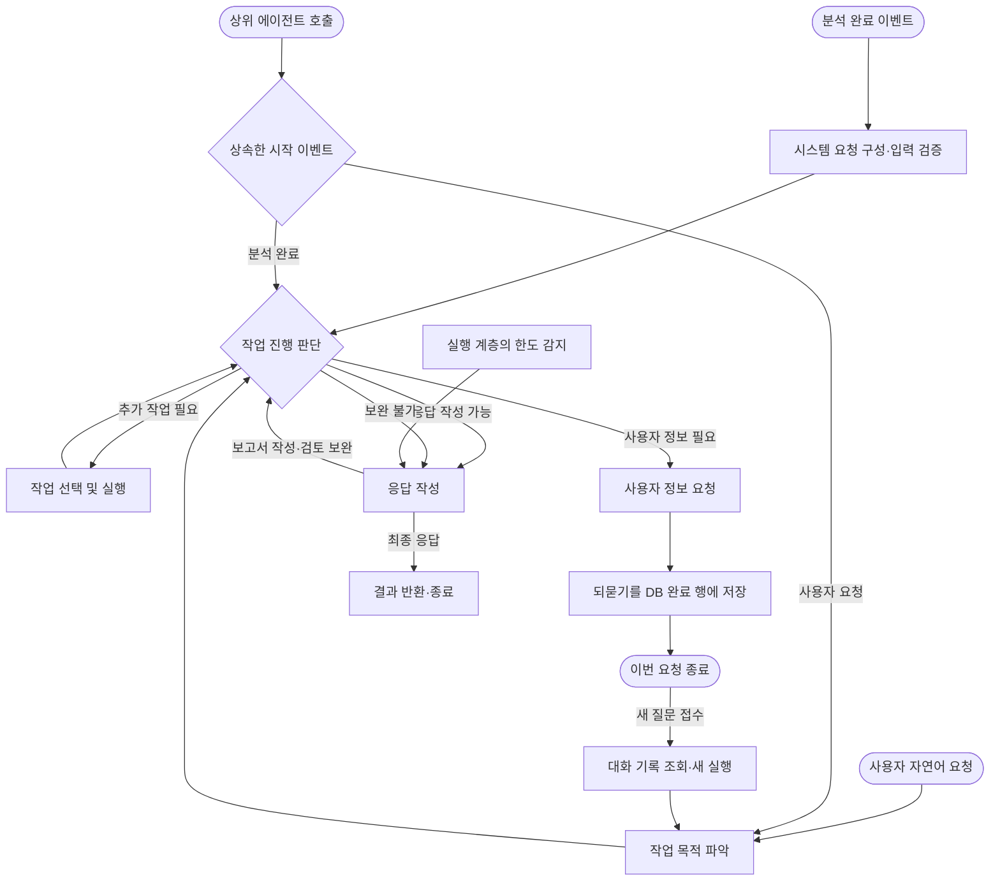
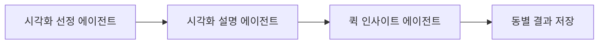

# AI 에이전트 실행 흐름

수정일: 2026-11-12.

에이전트는 작업 진행 판단에서 현재 정보가 충분한지 확인하고, 부족하면 필요한 정보를 정한다. 작업 선택 및 실행은 그 판단에 맞는 도구·하위 에이전트와 입력 인자를 선택해 호출한다. 이 문서는 시작 원인에 따른 진입 단계와 실행 중 응답·질문·종료·재시도 경로를 정의한다.

## 1. 시작 이벤트

| 시작 | 입력 구성 | 진입 |
| --- | --- | --- |
| 분석 파이프라인 완료 | 시스템이 goal에 목적·분석 대상·범위를 서술하고 constraints와 시스템 지침 messages 구성 | 입력 검증 후 해당 에이전트의 작업 진행 판단으로 진입. 보고서 API는 §2.2의 순차 흐름을 사용하며 작업 목적 파악 생략 |
| 사용자 자연어 요청 | 실제 발화·관련 화면·대화 정보 제공 | 사용자 요청 처리 에이전트의 작업 목적 파악 |
| 상위 에이전트 호출 | 상위 State의 목적·조건·대화·이벤트·공유 예산으로 하위 State 구성 | 상속한 execution.event에 따라 진입하고 필요한 자료 조회. 반환값은 상위 results에 기록 |

백엔드는 사용자 질문 행을 저장·커밋한 뒤 conversationId·messageId와 선택적 context로 실행 요청 POST를 보낸다. AI 서버는 질문 행을 조회하고 본문 없는 202로 접수를 확인한다. 서버 간 연결과 공유 DB 구조는 [아키텍처](../architecture.md)를 따른다.

분석 완료 후에는 백엔드가 요청 식별자·기준 월·대상 행정동 목록으로 보고서 생성을 요청한다. AI 서버는 결과를 직접 저장하고 전체 처리 후 완료 알림을 보낸다. 입력 필드와 저장·알림 계약은 [연동 API](../runtime/api.md#2-보고서-생성)를 따른다.

자동 실행에 가짜 사용자 발화를 만들지 않는다. 초기 입력의 필수값·허용 범위 검사는 요청을 다시 해석하는 모델 노드와 구분한다. 공통 subject는 두지 않으며 확인된 대상·참조는 goal에서 충분히 특정한다.

## 2. 에이전트 공통 실행 흐름

그림 1. 모든 에이전트가 사용하는 공통 실행과 다음 질문 처리 흐름. 일반 업무의 응답 작성은 최종 응답으로 종료하고, 보고서의 작성·검토 보완은 진행 판단을 거친다. 사용자 답변은 새 질문이며 대화 기록을 읽어 새 실행의 작업 목적을 파악한다. 사용자 요청의 안내·저장 기준은 §2.1을 따른다.

| 단계 | 코드 식별자 | 처리 | 이력 |
| --- | --- | --- | --- |
| 작업 목적 파악 | `interpret` | 목적·대상·조건·완료 기준을 파악하고 goal·constraints 구체화. 파악 후 작업 진행 판단으로 이동 | 파악 결과를 results에 기록 |
| 작업 진행 판단 | `decide` | 전체 목표·확보 결과·작성 및 검토 이력으로 현재 정보의 충분성과 필요한 정보를 판단해 추가 작업·사용자 정보·응답 작성 중 다음 진행 방향 결정 | output.next에 다음 단계, output.reason과 기록의 reason에 부족한 정보·판단 근거를 기록 |
| 작업 선택 및 실행 | `act` | 최근 진행 판단이 지정한 부족 정보를 확보할 도구·에이전트·입력 인자를 모델 1회로 선택하고 호출. 도구 입력·설정 검사와 호출 결과를 기록하고 작업 진행 판단으로 이동 | 선택 이유, 호출 결과, 도구의 부적합 판정, 재시도를 results에 기록 |
| 응답 작성 | `compose` | 사용할 결과로 설명·해석·공개 산출물과 근거·한계·미해결 사항 구성 | 작성 이력은 results, 현재 공개 내용은 response |
| 사용자 정보 요청 | `ask` | 사용자가 제공해야 하는 필수 정보를 구체적인 질문으로 작성 | 질문 이력은 results, 현재 질문은 response |

작업 진행 판단만 정보의 충분성·부족한 정보·진행 방향을 결정한다. 자료가 충분하면 작업 선택 및 실행을 거치지 않고 응답을 작성하며, 사용자만 제공할 필수 정보가 필요하면 사용자 정보 요청으로 이동한다. 작업 선택 및 실행은 기존 results의 최근 진행 판단을 읽고 구체적인 도구·조회 조건·입력 인자를 정한다. 호출 생략을 선택하거나 충분성을 다시 판단하지 않으며, 호출 후 별도 모델 검증을 수행하지 않는다. 성공한 호출 결과를 후속 계산·응답의 후보로 사용하고 실패·부적합 결과는 제외한다. 보고서의 세 에이전트도 이 노드들을 사용하며 각자 응답 작성에서 자기 산출물을 작성·검토한다. 상세 계약은 [보고서 생성 흐름](report.md)을 따른다.

일반 사용자 요청·해석·시각화의 응답 작성은 최종 응답을 반환하고 종료한다. 보고서 역할은 작성·검토에서 후속 판단이 필요하면 `intermediate` 응답으로 진행 판단에 돌아간다. 부족 정보와 부적합 사유를 `results`에 남기고, 진행 판단이 추가 조회·가공 또는 재작성 여부를 결정한다. 응답 작성에서 작업 선택이나 사용자 정보 요청으로 직접 이동하지 않는다.

정상 조회의 자료 없음과 호출 실패를 구분한다. 자료가 없다는 이유만으로 같은 호출을 반복하지 않는다. 잘못된 결과와 수정 결과의 이력을 보존하고 부적합 결과를 공개하지 않는다. 응답 작성 가능 판정은 필요한 자료가 확보됐다는 뜻이며, 아직 작성하지 않은 해석 내용의 검사 통과를 뜻하지 않는다.

각 노드가 수정할 수 있는 필드는 [State §2](state.md#2-노드별-쓰기-범위)를 따른다. 모델이 읽을 수 있는 정보는 이 쓰기 범위와 다르며, 현재 구성과 남은 결정은 [컨텍스트](context.md)에서 관리한다.

### 2.1 사용자 요청의 진행 안내와 결과 전달

| 상황 | 응답 종류 | 공개 내용 작성 | 이후 실행 |
| --- | --- | --- | --- |
| 각 최상위 업무 노드 시작 | `progress` | 런타임이 단계 이름을 `label`·`content`에 쓰고 기존 공개 산출물 보존 | 실행 중 상태(`running`)로 저장·알림 후 해당 노드 실행 |
| 요청 완료 또는 제공 범위 확정 | `final` | 응답 작성에서 유효 결과와 미해결 사항 통합 | 실제 결과에 맞는 상태로 종료 |
| 사용자 답변 필요 | `question` | 사용자 정보 요청에서 질문 작성, 현재 제공 가능한 산출물 유지 | 내부 상태는 `waiting_input`. DB에는 완료 행을 저장하고 이번 요청 종료 |

진행 안내 문구는 `질문 이해`, `진행 판단`, `자료 조회·작업 실행`, `답변 작성`, `추가 질문 작성`의 단계별 고정값이다. 모델이 각 노드의 결과를 요약해 작성하지 않는다. 도구·하위 에이전트의 새 결과는 상위 `results`에 기록하며, 하위 실행의 진행·응답을 별도로 사용자 대화에 저장·알림하지 않는다.

AI 서버는 각 진행·종료 행을 `ai_message`에 저장·커밋한 뒤 `conversationId`와 새 행의 `messageId`로 백엔드에 POST 알림을 보낸다. 프론트는 1초마다 새 행을 조회해 진행 문구·상세 설명을 표시하고 종료 행을 받으면 조회를 멈춘다. 지도·차트 등 산출물은 완료 행의 것만 표시한다. 상세 계약은 [연동 API](../runtime/api.md#14-실행저장알림)를 따른다.

공통 그래프는 `intermediate` 응답을 받으면 진행 판단으로 되돌아가는 경로와 공개 콜백을 지원한다. 이 경로는 보고서 내부 보완과 모의 출력 시험에서 사용하며, 일반 사용자 요청에서 새 중간 결과를 작성·공개하는 동작으로 사용하지 않는다. `partial`은 일부 결과로 실행을 끝낸 상태다.

### 2.2 보고서 에이전트의 순차 실행

그림 2. 정상 보고서 생성 순서. 보고서의 차이는 세 에이전트를 정해진 순서로 실행하는 것이며, 각 에이전트 내부의 노드 전이는 그림 1과 같다. 작성·검토 후에는 같은 역할의 진행 판단에서 추가 작업이나 재작성을 결정한다. 후속 역할에서 앞 역할로 돌아가는 실행 경로는 두지 않는다.

한 동의 세 에이전트는 동일한 State의 요청·이력·누적 예산을 이어 쓴다. 선정·검토를 통과한 설명은 후속 단계가 읽는 확정 입력이며, 후속 조회 결과는 자기 단계의 새 이력으로 보관한다. 단계별 입력·완료 기준과 실패 단계 재처리·부분 저장은 [보고서 생성](report.md), 여러 동의 실행·저장·완료 알림은 [API 계약](../runtime/api.md#2-보고서-생성)을 따른다.

## 3. 질문과 종료

| 상황 | 처리 |
| --- | --- |
| 핵심 정보 부족 | 되묻기를 완료 행으로 저장하고 현재 요청 종료 |
| 다음 입력 | DB 대화 기록을 읽어 새 State·새 예산으로 시작. AI가 이전 내용의 후속인지 새 요청인지 판단 |
| 일부만 처리 가능 | 유효 결과·한계를 partial로 반환하고 DB 완료 행에 저장 |
| 목표 충족 | completed 응답을 DB 완료 행에 저장 |
| 한도 도달 | 기존 State의 종료 응답 예산 안에서 마무리하되 전체 커밋 마감 시간을 우선 적용 |
| 취소·오류 | 후속 실행 중단 후 취소·실패 끝 행 저장 |

내부 질문 생성은 `waiting_input` 상태로 반환하지만 서비스 API는 중단 시점에 저장한 실행을 이어받지 않는다. 공통 실행기의 질문 재개 기능은 로컬 검증용이며 HTTP API에서는 사용하지 않는다. 종료·진행 행을 커밋한 뒤 보내는 알림과 시간 제한·중복 요청·알림 실패 처리는 [연동 API](../runtime/api.md)를 따른다.

## 4. 오류와 재시도

| 상황 | 처리 |
| --- | --- |
| 입력 오류·권한 부족 | 수정 항목 반환 또는 접근 거부 |
| 결과 없음 | 부족한 정보와 확보 가능 범위를 다시 판단 |
| 일시적 읽기 장애 | 허용 조건·한도 안에서 재시도하고 각 시도를 results에 기록 |
| 작업 결과 부적합 | 검증 결과·이유를 별도 작업 기록으로 남기고 보완 또는 반환 |
| 저장 응답 유실 | 요청 ID로 실제 상태 조회. 확인 전 재실행 금지 |
| 비교 기준 불일치 | 해당 비교 중단 또는 설명 범위 제한 |

도구 오류·실제 자료 버전은 해당 output에, 실행 전체의 오류·한도는 execution에 기록한다. 조회 실패를 자료 없음으로, 확인되지 않은 저장을 성공으로 표시하지 않는다. 일반 호출 수·단계·실행 시간의 한도값은 최상위 State 초기화에서 지정한다. 상위·하위의 공유 사용량, 보완 호출의 재시도 집계, 한도 후 모델 최대 1회·30초의 종료 예산은 [State의 실행 예산](state.md#실행-예산)을 따른다. 비용 한도는 별도로 확정하지 않았다.
