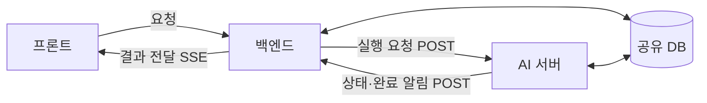

# AI Agent 아키텍처

수정일: 2026-11-06.

## 1. 구성

| 구성 | 역할 | 기술안 |
| --- | --- | --- |
| 프론트 | 사용자 요청 전달, 결과 표시 | 세부 연동 미정 |
| 백엔드 | 사용자 질문 저장, AI 실행 요청, 저장된 AI 행 조회·프론트 전달 | HTTP POST |
| AI API | 질문 행 조회·실행 접수, AI 진행·결과 저장 후 백엔드에 알림 | FastAPI·HTTP POST |
| Agent 런타임 | 작업 선택 및 실행(호출·개별 검증 포함), 작업 진행 판단 연결, 이력·쓰기 범위·실행 한도 관리 | LangGraph·LangChain |
| 모델 | 해석·추론·응답 생성 | OpenAI API |
| 도구 | 자료 조회, 계산·변환, 시각화 산출물 생성 | 업무 함수·API / Pydantic 입력 검증 |
| 공유 DB | 백엔드·AI 서버의 데이터 저장·조회, AI 실행 상태 저장·복원 | PostgreSQL, AI 체크포인트는 Checkpointer 사용 |

구성 요소별 역할과 기술안을 정리한다. 도구 입출력과 Agent별 역할은 [기능 명세](ieumi-agent-components.md), 실행 순서와 예외 처리는 [실행 흐름](ieumi-agent-workflow-design.md)을 따른다.

사용자 요청에서 백엔드는 질문 행을 저장한 뒤 실행 요청 POST를 보내고, AI 서버는 진행·결과 행을 저장한 뒤 알림 POST를 보낸다. 두 POST의 본문은 conversation_id와 message_id이며 수신 서버는 공유 DB에서 내용을 조회한다. 성공 응답은 본문 없이 각각 202·204다.

분석 파이프라인 완료 시에는 백엔드가 본문 없는 POST로 해석 Agent를 호출한다. AI 서버는 접수 응답 후 해석·DB 적재를 마치고 별도 POST로 완료를 알린다. 상세 범위는 [연동 API 초안 §2.2](ai-runtime-api-20261029.md#22-분석-해석)을 따른다.

그림 1. 서버 연동 구조. 원본: 이 문서의 Mermaid 코드.

프론트·백엔드 구간은 각 담당자가 구체화한다. AI 구현은 백엔드와의 POST·공유 DB 계약을 기준으로 하며 프론트의 SSE·표시 방식에 의존하지 않는다. 세부 계약과 미확정 항목은 [연동 API 초안](ai-runtime-api-20261029.md)에서 관리한다.

## 2. 상태와 배포 경계

내부 작업 이력은 results, 현재 공개할 안내·중간/최종 결과·질문은 response에 둔다. 서버는 내부 이력이나 시스템 메시지 전체를 화면에 전달하지 않는다. 상세 필드·노드별 쓰기 범위는 [State](ieumi-agent-state.md)를 따른다.

분석 완료 이벤트는 시스템이 요청·지침을 구성한 뒤 작업 목적 파악을 생략하고 해석 Agent의 작업 선택 및 실행으로 연결한다. 사용자 질문 대기 시에는 State·질문·재개 위치를 저장한 뒤 현재 처리 작업을 종료할 수 있다. 답변이 오면 같은 실행 ID로 복원해 이어간다. 영속 저장·재개는 설계 기준이며 현재 구현 완료를 뜻하지 않는다.

지침·도구·API는 한 배포 구성으로 관리하고 execution.version으로 식별한다. 자료 버전은 배포 버전과 분리해 조회 작업 output에 보존한다. 다른 배포에서 대기 실행을 재개하는 정책은 API 협의 항목이다.
