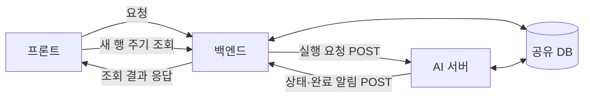

# AI 아키텍처

수정일: 2026-11-11.

AI는 지역 분석 결과를 해석하고, 사용자 요청에 맞는 설명과 시각화 결과를 제공한다. 
에이전트가 업무 판단을 맡고, 런타임이 요청 접수·실행·저장·전달을 담당한다.

두 구성 요소는 요청·작업 이력·응답을 담은 [실행 상태](agent/state.md)(`State`)로 자료와 결과를 전달한다. 
에이전트는 내부 기록과 구분해 공개 응답을 작성하고, 런타임은 이를 저장·전달한다.

## 1. 구성

| 구성 | 역할 | 기술안 |
| --- | --- | --- |
| 프론트 | 사용자 요청 전달, 새 행을 1초마다 조회해 진행 안내·답변 표시, 완료 행의 산출물 표시 | HTTP 주기 조회 |
| 백엔드 | 사용자 질문 저장, AI 실행 요청, 저장된 AI 행 조회·프론트 전달 | HTTP POST |
| AI API | 질문 행 조회·실행 접수, AI 진행·결과 저장 후 백엔드에 알림 | FastAPI·HTTP POST |
| 에이전트 실행기 | 에이전트 실행 순서·모델 및 도구 호출·이력·실행 한도 관리 | LangGraph·LangChain |
| 모델 | 해석·추론·응답 생성 | OpenAI API |
| 도구 | 자료 조회, 계산·변환, 시각화 산출물 생성 | 업무 함수·API, 입력 검사는 Pydantic 사용 |
| 공유 DB | 백엔드·AI 서버의 데이터 저장·조회, 내부 실행 상태 저장·복원 | PostgreSQL, 실행 상태의 저장·복원은 Checkpointer 사용 |

도구 입출력과 에이전트별 역할은 [기능 명세](agent/components.md), 실행 순서와 예외 처리는 [실행 흐름](agent/workflow.md)을 따른다.

보고서 생성은 시각화 선정·시각화 설명·퀵 인사이트 에이전트를 순차 실행하는 흐름이다. 각 에이전트는 공통 실행기에서 자기 산출물을 판단·작성하며, 보고서 생성 흐름은 동별 실행·저장·완료 알림을 관리한다. 한 동의 단계 간 전달·실행 예산과 앞 단계 산출물 보존 기준은 [보고서 생성](agent/report.md)을 따른다.

## 2. 서버 연동

| 시작 계기  | 백엔드 요청                                 | AI 서버의 실행·저장·알림                                     |
| ------ | -------------------------------------- | --------------------------------------------------- |
| 사용자 질문 | 질문 행을 저장한 뒤 실행 요청 전송                   | 질문을 조회해 실행. 진행·결과 행을 저장한 뒤 저장한 행을 백엔드에 알림           |
| 분석 완료  | 대상 월·행정동의 [보고서 생성](agent/report.md) 요청 | 동별 보고서를 생성해 직접 저장. 전체 처리가 끝나면 저장 건수와 실패한 동을 백엔드에 알림 |

서버 간 실행 요청과 알림은 HTTP POST로 전달하고, 사용자 질문·진행·결과 본문은 공유 DB에서 조회한다. 상세 계약은 [연동 API](runtime/api.md)를 따른다.

그림 1. 서버 연동 구조.

프론트·백엔드 조회 방식은 [패널 계약](../../docs/api/ai-agent-panel.md)을 따른다.
