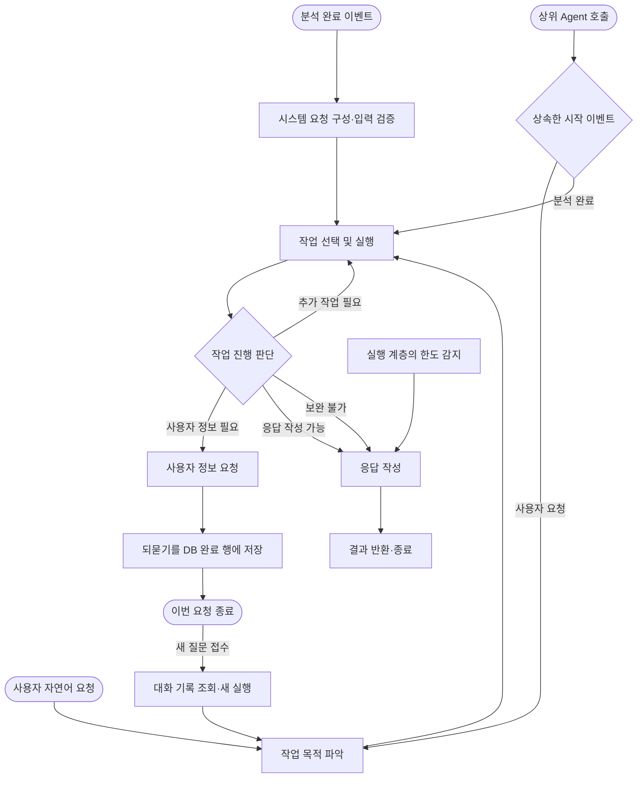

# AI Agent 실행 흐름

수정일: 2026-11-06.

## 1. 시작 이벤트

| 시작 | 입력 구성 | 진입 |
| --- | --- | --- |
| 분석 파이프라인 완료 | 시스템이 goal에 목적·분석 대상·범위를 서술하고 constraints와 시스템 지침 messages 구성 | 입력 검증 후 해석 Agent의 작업 선택 및 실행으로 진입. 작업 목적 파악 생략 |
| 사용자 자연어 요청 | 실제 발화·관련 화면·대화 정보 제공 | 사용자 요청 처리 Agent의 작업 목적 파악 |
| 상위 Agent 호출 | 상위 State의 목적·조건·대화·이벤트·공유 예산으로 하위 State 구성 | 상속한 execution.event에 따라 진입하고 필요한 자료 조회. 반환값은 상위 results에 기록 |

백엔드는 사용자 질문 행을 저장·커밋한 뒤 conversationId·messageId와 선택적 context로 실행 요청 POST를 보낸다. AI 서버는 질문 행을 조회하고 본문 없는 202로 접수를 확인한다. 서버 간 연결과 공유 DB 구조는 [아키텍처](ai-agent-architecture.md)를 따른다.

분석 완료 후에는 BE가 requestId·month·dongCodes로 보고서 생성을 요청한다. AI는 직접 저장하고 전체 처리 후 INT-08로 알린다. [연동 API](ai-runtime-api-20261029.md)를 따른다.

자동 실행에 가짜 사용자 발화를 만들지 않는다. 초기 입력의 필수값·허용 범위 검사는 요청을 다시 해석하는 모델 노드와 구분한다. 공통 subject는 두지 않으며 확인된 대상·참조는 goal에서 충분히 특정한다.

## 2. Agent 공통 실행 흐름

그림 1. 기본 실행과 다음 질문 처리 흐름. 사용자 답변은 새 질문이며 대화 기록을 읽어 새 실행의 작업 목적을 파악한다. 요청 처리 Agent의 중간 응답 후 계속 경로는 §2.1을 따른다.

| 단계 | 코드 식별자 | 처리 | 이력 |
| --- | --- | --- | --- |
| 작업 목적 파악 | `interpret` | 목적·대상·조건·완료 기준을 파악하고 goal·constraints 구체화 | 파악 결과를 results에 기록 |
| 작업 선택 및 실행 | `act` | 모델 1회로 필요한 도구·Agent·입력 인자를 선택하고 호출. 도구 입력·설정 검사와 호출 결과를 기록하고 작업 진행 판단으로 이동 | 선택 이유, 호출 결과, 도구의 부적합 판정, 재시도를 results에 기록 |
| 작업 진행 판단 | `decide` | 전체 목표와 확보 결과를 비교해 충분 여부·부족한 내용·사용자 정보 필요·응답 작성 가능 여부 결정 | decision에 부족한 내용을 구체적으로 기록하고 reason에 근거 요약 |
| 응답 작성 | `compose` | 사용할 결과로 설명·해석·공개 산출물과 근거·한계·미해결 사항 구성 | 작성 이력은 results, 현재 공개 내용은 response |
| 사용자 정보 요청 | `ask` | 사용자가 제공해야 하는 필수 정보를 구체적인 질문으로 작성 | 질문 이력은 results, 현재 질문은 response |

작업 진행 판단은 부족한 정보와 진행 방향을 결정한다. 구체적인 도구·쿼리·입력 인자는 작업 선택 및 실행에서 정한다. 작업 선택 및 실행은 호출 후 모델 검증을 수행하지 않는다. 성공한 호출 결과를 후속 계산·응답의 후보로 사용하고 실패·부적합 결과는 제외한다. 작업 진행 판단은 기존처럼 전체 목표와 확보 결과를 비교한다. 보고서 전용 응답 작성의 선정·작성·검토는 [보고서 생성 흐름](temp/analysis-report-workflow.md)을 따른다.

정상 조회의 자료 없음과 호출 실패를 구분한다. 자료가 없다는 이유만으로 같은 호출을 반복하지 않는다. 잘못된 결과와 수정 결과의 이력을 보존하고 부적합 결과를 공개하지 않는다. 응답 작성 가능 판정은 필요한 자료가 확보됐다는 뜻이며, 아직 작성하지 않은 해석 내용의 검사 통과를 뜻하지 않는다.

노드별 State 쓰기 범위는 [State §2](ieumi-agent-state.md#2-노드별-쓰기-범위)를 따른다. 읽기·모델 컨텍스트 선별과 혼동하지 않는다. 세부 제공 방침은 [컨텍스트](ai-agent-context.md)에서 추후 확정한다.

### 2.1 사용자 요청 처리 Agent의 중간 응답

| 상황 | 공개 처리 | 이후 실행 |
| --- | --- | --- |
| 조회·계산 등 진행 안내 | 작업 선택 및 실행과 작업 진행 판단에서 response.kind=progress로 안내. 유효한 기존 공개 산출물 보존 | running 유지 |
| 공개할 개별 결과 확보 | 응답 작성에서 response.kind=intermediate로 결과·근거·한계·남은 작업 구성 | 다음 작업 또는 질문으로 진행 |
| 요청 완료 또는 제공 범위 확정 | 응답 작성에서 response.kind=final로 유효 결과와 미해결 사항 통합 | 실제 결과에 맞는 상태로 종료 |
| 사용자 답변 필요 | response.kind=question으로 질문 작성, 현재 제공 가능한 산출물 유지 | 내부 waiting_input. DB에는 완료 행을 저장하고 이번 요청 종료 |

응답 작성에서 공개할 내용을 구성하면 AI 서버가 ai_message에 저장·커밋하고, conversationId와 새 AI 행의 messageId로 백엔드에 POST 알림을 보낸다. 중간 결과는 진행 행의 details·artifacts에 저장하고 완료 행은 이번 질문을 끝낼 때 저장하며 되묻기도 포함한다. 백엔드는 해당 행을 조회·반영하고 본문 없는 204를 반환한다. 프론트 전달·표시는 백엔드·프론트 담당 범위다.

공개 응답은 현재 표시할 전체 내용이다. 유효한 기존 산출물을 포함하고, 수정·제외 시 이유를 설명한다. partial은 일부 작업만 마친 종료 상태이며 진행 중 중간 결과와 구분한다. 백엔드 알림과 DB 저장은 [연동 API 초안](ai-runtime-api-20261029.md)을 따른다.

## 3. 질문과 종료

| 상황 | 처리 |
| --- | --- |
| 핵심 정보 부족 | 되묻기를 완료 행으로 저장하고 현재 요청 종료 |
| 다음 입력 | DB 대화 기록을 읽어 새 State·새 예산으로 시작. AI가 이전 내용의 후속인지 새 요청인지 판단 |
| 일부만 처리 가능 | 유효 결과·한계를 partial로 반환하고 DB 완료 행에 저장 |
| 목표 충족 | completed 응답을 DB 완료 행에 저장 |
| 한도 도달 | 기존 State의 종료 응답 예산 안에서 마무리하되 전체 커밋 마감 시간을 우선 적용 |
| 취소·오류 | 후속 실행 중단 후 취소·실패 끝 행 저장 |

내부 질문 생성은 waiting_input 상태로 반환하지만 서비스 API는 체크포인트를 이어받지 않는다.
공통 실행기의 질문 재개 기능은 로컬 검증용이며 HTTP API에서는 사용하지 않는다.
종료·진행 행은 커밋한 뒤 INT-07로 알린다. 시간·중복·알림 실패 처리는
[연동 API](ai-runtime-api-20261029.md)를 따른다.

## 4. 오류와 재시도

| 상황 | 처리 |
| --- | --- |
| 입력 오류·권한 부족 | 수정 항목 반환 또는 접근 거부 |
| 결과 없음 | 부족한 정보와 확보 가능 범위를 다시 판단 |
| 일시적 읽기 장애 | 허용 조건·한도 안에서 재시도하고 각 시도를 results에 기록 |
| 작업 결과 부적합 | 검증 결과·이유를 별도 작업 기록으로 남기고 보완 또는 반환 |
| 저장 응답 유실 | 요청 ID로 실제 상태 조회. 확인 전 재실행 금지 |
| 비교 기준 불일치 | 해당 비교 중단 또는 설명 범위 제한 |

도구 오류·실제 자료 버전은 해당 output에, 실행 전체의 오류·한도는 execution에 기록한다. 조회 실패를 자료 없음으로, 확인되지 않은 저장을 성공으로 표시하지 않는다. 일반 호출 수·단계·실행 시간의 한도값은 최상위 State 초기화에서 지정한다. 상위·하위의 공유 사용량, 보완 호출의 재시도 집계, 한도 후 모델 최대 1회·30초의 종료 예산은 [State의 실행 예산](ieumi-agent-state.md#실행-예산)을 따른다. 비용 한도는 별도로 확정하지 않았다.
