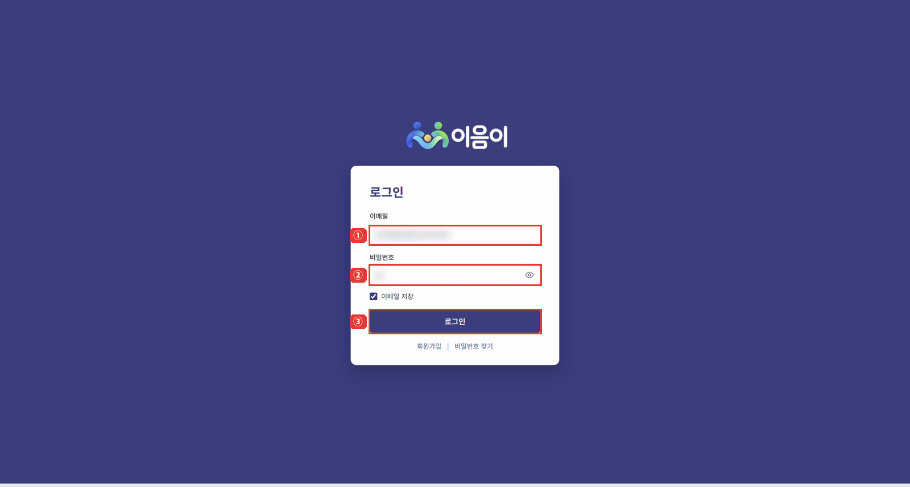
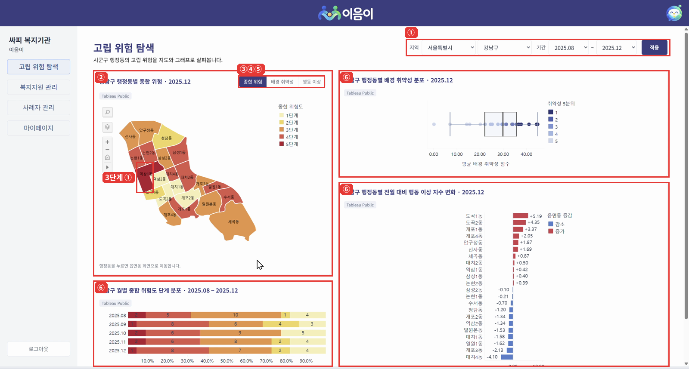
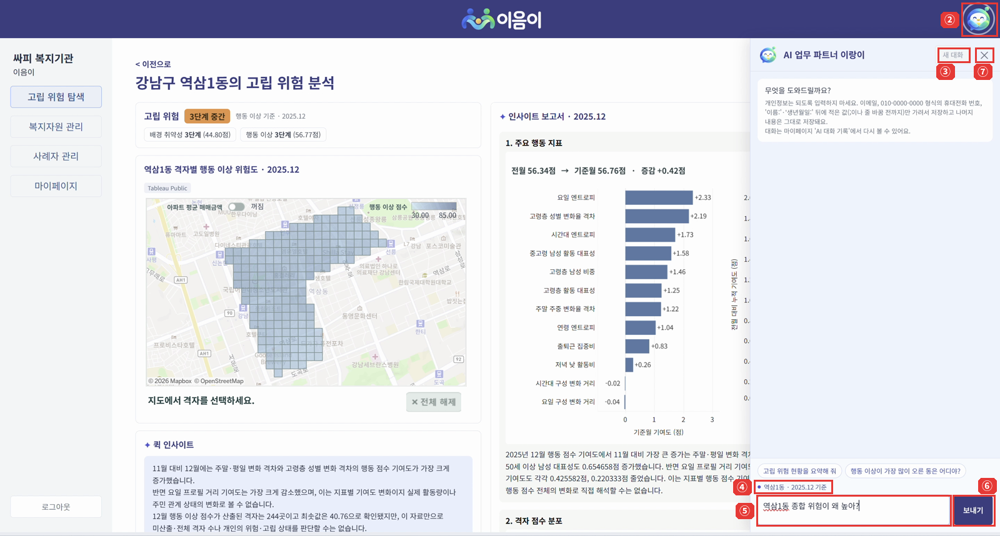
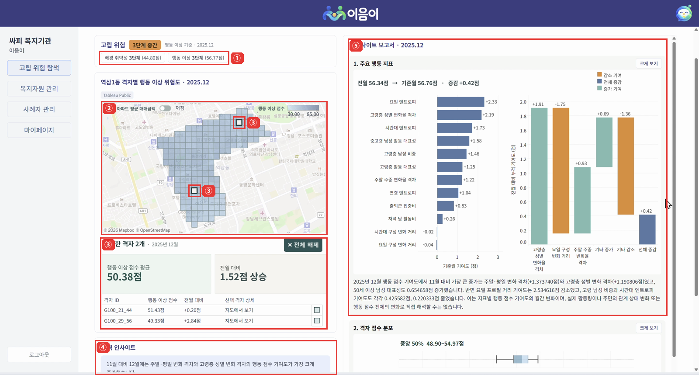
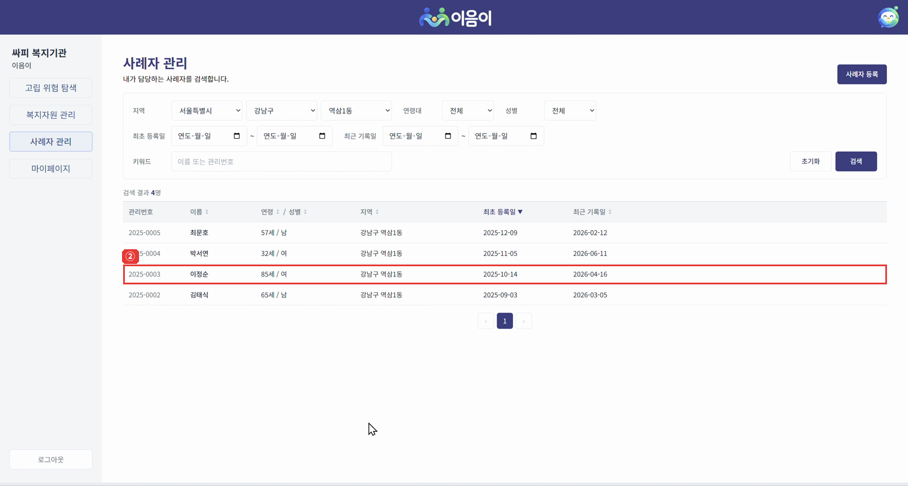
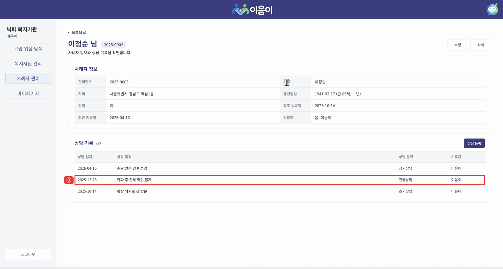
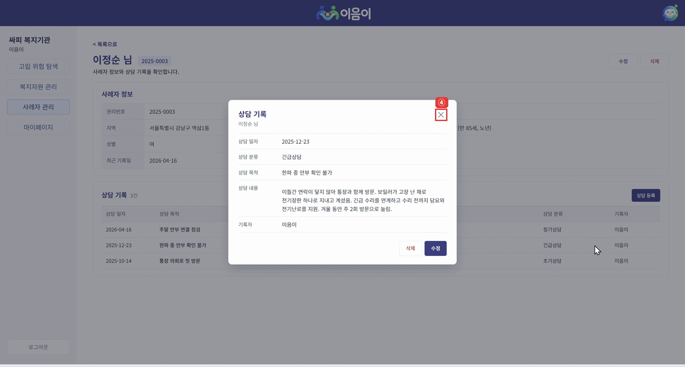
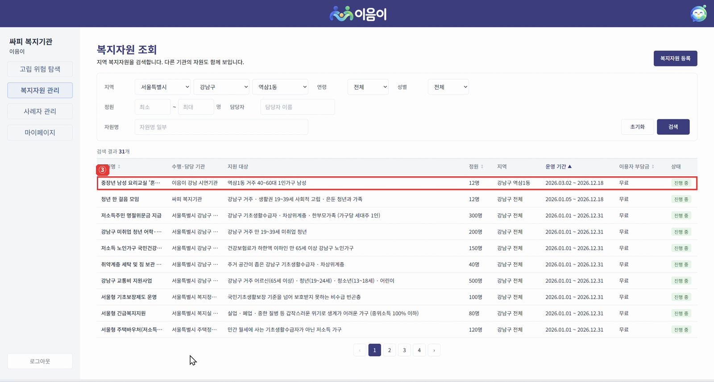
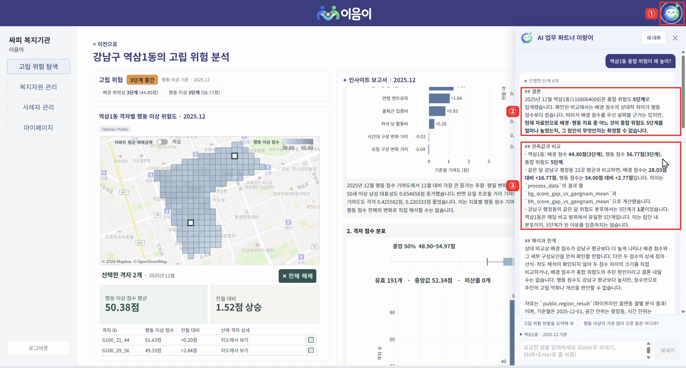
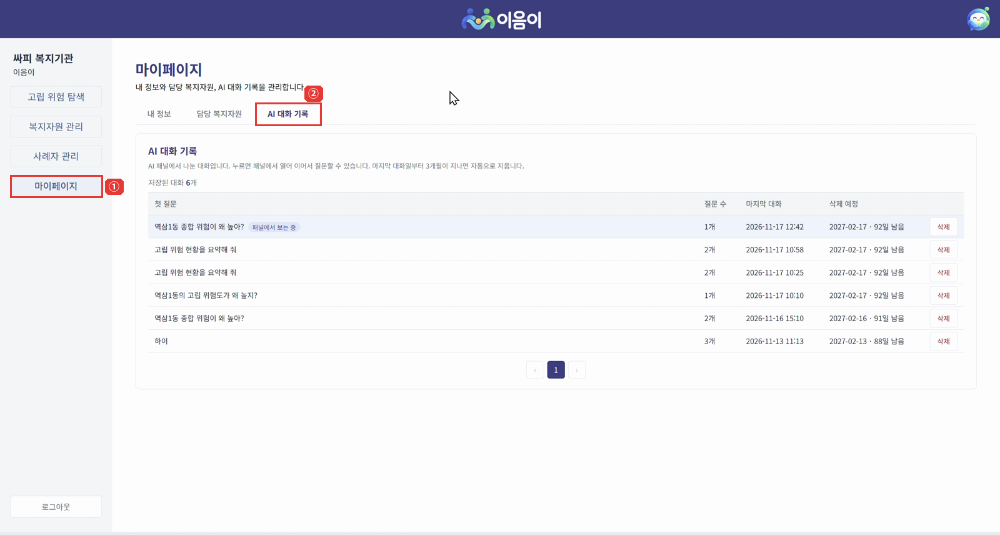

# 4. 시연 시나리오 — 이음이 (Eumi)

복지기관 담당자가 **위험 지역을 찾고 → 위험이 높은 이유를 AI에게 물어 두고 → 화면으로 직접 확인하고 → 실제 업무(사례자 · 복지자원)로 이어 간 뒤 → AI의 답을 확인하는** 흐름을 한 번에 보여 줍니다.

- **예상 시간**: 약 6분 35초 (말하는 시간 포함)
- **주소**: https://k15b201.p.ssafy.io
- **계정**: 시연 계정 (로그인하면 왼쪽 위에 "싸피 복지기관 · 이음이"로 표시). 로그인 정보는 따로 전달합니다.
- **화면**: 크롬, 1920×1080, 확대 100%, 북마크바 숨김
- **시연 지역**: 서울 강남구 역삼1동, 2025년 12월
- **AI 질문**: 패널 입력칸에 **"역삼1동 종합 위험이 왜 높아?"** 를 입력해 보냅니다. 동 이름은 붙여 쓰고, 예시 질문은 누르지 않습니다.
- **대본**: 단계마다 동작과 말할 내용을 함께 적었습니다. 말은 1초에 4음절 안팎으로 잡아, 누르고 화면이 뜨는 시간을 남겼습니다. "여유 있으면" 줄은 시간이 남을 때만 말합니다.

## 목차

1. [시연 전 준비](#1-시연-전-준비)
2. [한눈에 보는 순서](#2-한눈에-보는-순서)
3. [단계별 상세와 대본](#3-단계별-상세와-대본)
4. [문제가 생기면](#4-문제가-생기면)
5. [하지 않을 것](#5-하지-않을-것)
6. [근거: 실측 시간](#6-근거-실측-시간)

---

## 1. 시연 전 준비

시연 30분 전에 서버(jenkins 계정)와 PC에서 차례로 확인합니다.

| 순서 | 확인 | 방법 |
|---|---|---|
| 1 | GMS 남은 크레딧 | GMS 사용 내역 화면. 질문 하나에 약 170, 실패하면 200 ~ 300 |
| 2 | AI 실행 기록 공간 비우기 | 진행 중인 질문이 없을 때 `sudo docker restart eumi-ai-1` |
| 3 | 메일함 비우기 | Mailpit 화면(SSH 터널)에서 전체 삭제 |
| 4 | 시연 데이터 되돌리기 | `restore.sh` → 개수 확인 (members 3 · cases 6 · case_managers 13 · consultations 15 · resources 3) |
| 5 | 역삼1동 보고서 | 상세 화면 보고서 아래에 "AI 생성 · 2026-11-13 13:59"가 보이는지 |
| 6 | 예비 대화 | 마이페이지 → AI 대화 기록에 시연 계정으로 받은 **"역삼1동 종합 위험이 왜 높아?" 완료 대화**가 있는지. 답의 첫 줄이 "역삼1동 … 5단계"이고 같은 달 강남구 다른 동과 비교한 단락이 있어야 함. 지금은 **마지막 대화 2026-11-17 12:42** 대화가 이 조건에 맞음. 없으면 역삼1동 상세 화면에서 같은 질문을 보내 만들어 둠 (4번 되돌리기로는 지워지지 않음). 목록에서 구분할 수 있게 이 대화의 "마지막 대화" 시각을 적어 둠 |
| 7 | 시작 화면 | AI 패널에서 "새 대화"를 눌러 비워 두고 패널을 닫은 뒤, 로그아웃하고 로그인 화면을 띄워 둠 |

---

## 2. 한눈에 보는 순서

| 시간 | 단계 | 화면 | 보여 줄 것 |
|---|---|---|---|
| 0:00 ~ 0:20 | 1 | 로그인 | 기관 계정으로만 쓰는 서비스 |
| 0:20 ~ 1:40 | 2 | 고립 위험 탐색 | 두 지수로 본 고립 위험, 지도 · 그래프 4개 |
| 1:40 ~ 2:10 | 3 | 역삼1동 진입 · AI 질문 | 동에 들어가자마자 질문을 보내 두고 패널을 닫음 |
| 2:10 ~ 3:30 | 4 | 역삼1동 상세 | 100m 격자 지도와 격자 선택, AI 퀵 인사이트 · 보고서 |
| 3:30 ~ 4:45 | 5 | 사례자 | 역삼1동 사례자 → 긴급상담 기록 |
| 4:45 ~ 5:30 | 6 | 복지자원 | 역삼1동 자원 → '혼밥 탈출' |
| 5:30 ~ 6:15 | 7 | AI 답변 | 보내 둔 질문의 답변 (기대와 다르면 8단계 예비 대화로) |
| 6:15 ~ 6:35 | 8 | 마이페이지 | 지난 대화 다시 보기 |

이 질문의 AI 답변은 1분 반에서 3분 남짓 걸립니다 ([6장](#6-근거-실측-시간)). 질문을 2:05쯤 보내고 4 ~ 6단계를 보여 주는 약 3분 반 동안 답이 만들어지도록 순서를 짰습니다. 답이 실패하거나 기대와 다르게 오면 7단계에서 바로 8단계로 넘어가 예비 대화를 엽니다.

**시각 점검**: 2:05 질문 보냄 · 3:30 "사례자 탐색" 누름 · 4:45 메뉴 "고립 위험 탐색" 누름 · 5:30 AI 패널 엶. 4 ~ 6단계가 일찍 끝나면 "여유 있으면" 줄을 덧붙여 5:30 전에는 AI 패널을 열지 않습니다.

---

## 3. 단계별 상세와 대본

캡처의 빨간 상자 번호가 동작 표의 번호이고, 대본 표의 번호는 그 말을 하면서 하는 동작입니다. 다른 단계의 동작이 같은 화면에 있으면 "3단계 ①"처럼 단계를 붙였습니다. 위치는 1920×1080 화면 기준이고, 캡처는 11-17 리허설 녹화에서 뽑았습니다 (로그인 칸의 이메일 · 비밀번호는 가림).

### 1단계. 로그인 (0:00 ~ 0:20)

**주소**: `/login`

| 번호 | 위치 | 동작 | 결과 |
|---|---|---|---|
| ① | 가운데 "이메일" 칸 | 시연 계정 이메일 입력 | |
| ② | 그 아래 "비밀번호" 칸 | 비밀번호 입력 | |
| ③ | 파란 "로그인" 버튼 | 누름 | 0.4초 안에 고립 위험 탐색 화면 |

**대본**

| 동작 | 말 |
|---|---|
| ① ② 입력하는 동안 | 지금부터 이음이를 시연하겠습니다. 이음이는 복지기관 담당자를 위한 서비스로, 기관 공식 이메일로 인증한 담당자만 가입하고 로그인할 수 있습니다. |
| ③ 로그인 | 로그인하면 소속 기관의 관할 구가 바로 열립니다. |

**주의**: 화면 아래 "회원가입"은 누르지 않습니다 (실제 메일이 나가지 않음).

### 2단계. 고립 위험 탐색 (0:20 ~ 1:40)

**주소**: `/risk` (강남구 · 2025.08 ~ 2025.12)

| 번호 | 위치 | 동작 | 결과 |
|---|---|---|---|
| ① | 위쪽 필터 (지역 · 기간) | 보여 주기만 함 | 강남구, 2025.08 ~ 2025.12 |
| ② | 왼쪽 위 지도 패널 | 그래프가 뜨기를 기다림 | 그래프 4개가 4초 안에 뜸 |
| ③ | 지도 패널 오른쪽 위 "배경 취약성" | 누름 | 0.5초 뒤 지도가 바뀜 |
| ④ | 같은 자리 "행동 이상" | 누름 | 0.5초 뒤 지도가 바뀜 |
| ⑤ | 같은 자리 "종합 위험" | 누름 | 처음 지도로 돌아옴 |
| ⑥ | 아래 · 오른쪽 그래프 3개 | 짚어 주기만 함 | 월별 단계 분포, 배경 취약성 분포, 전월 대비 행동 이상 변화 |

**대본**

| 동작 | 말 |
|---|---|
| ① ② 그래프가 뜨는 동안 | 첫 화면은 고립 위험 탐색입니다. 우리 기관 관할인 강남구의 2025년 8월부터 12월까지가 기본으로 보입니다. |
| (지도 짚으며) | 이음이는 고립 위험을 두 갈래로 봅니다. 하나는 인구와 주택 통계로 본 배경 취약성, 다른 하나는 통신사 유동인구로 본, 평소와 다른 생활 패턴인 행동 이상입니다. |
| ③ 배경 취약성 | 배경 취약성으로 바꾸면 원래 고립되기 쉬운 조건을 가진 동이 보이고, |
| ④ 행동 이상 | 행동 이상으로 바꾸면 최근 생활 패턴이 평소와 달라진 동이 보입니다. |
| ⑤ 종합 위험 | 두 등급을 합친 것이 종합 위험으로, 1단계부터 5단계까지 나눕니다. 가장 진한 곳이 5단계, 오늘 살펴볼 역삼1동입니다. |
| ⑥ 그래프 짚기 | 아래와 오른쪽 그래프로는 달마다 단계별 동이 어떻게 바뀌었는지, 배경 취약성이 어떻게 분포하는지, 지난달보다 행동 이상이 얼마나 변했는지를 함께 봅니다. |
| (넘어가며) | 구 전체를 봤으니, 위험이 가장 높은 동으로 들어가 보겠습니다. |

**주의**: 화면이 뜬 뒤 **12초 이상** 이 화면에 머뭅니다. 그동안 역삼1동 상세가 뒤에서 미리 뜨고, 3단계에서 누르면 기다림 없이 바로 보입니다.

### 3단계. 역삼1동 진입 · AI 질문 보내기 (1:40 ~ 2:10)

**주소**: `/risk?dong=1168064000`

| 번호 | 위치 | 동작 | 결과 |
|---|---|---|---|
| ① | 2단계 지도 왼쪽 가운데의 가장 진한 빨간 동 (역삼1동) | 누름 | 바로 상세 화면 |
| ② | 화면 오른쪽 위 둥근 캐릭터 아이콘 (AI Agent 패널 열기) | 누름 | 오른쪽에 "AI 업무 파트너 이랑이" 패널 |
| ③ | 패널 위쪽 "새 대화" | 이전 대화가 보이면 누름 | 빈 대화 ("무엇을 도와드릴까요?") |
| ④ | 패널 아래, 입력칸 바로 위 "역삼1동 · 2025.12 기준" | 짚어 줌 | 보고 있는 화면 정보가 질문과 함께 감 |
| ⑤ | 패널 아래 입력칸 | **역삼1동 종합 위험이 왜 높아?** 입력 (동 이름은 붙여 씀) | |
| ⑥ | 입력칸 오른쪽 "보내기" | 누름 (Enter도 됨) | 0.1초 안에 "질문 이해" 단계 표시 |
| ⑦ | 패널 오른쪽 위 × | "질문 이해"가 뜬 것을 보고 누름 | 패널이 닫히고 상세 화면 전체가 보임. 답은 계속 만들어짐 |

**대본**

| 동작 | 말 |
|---|---|
| ① 역삼1동 누름 | 가장 진한 역삼1동으로 들어가 보겠습니다. |
| ② 패널 열기 | 이 동이 왜 위험한지는 먼저 AI 업무 파트너 이랑이에게 물어 두겠습니다. |
| ④ 짚기 → ⑤ 입력 | 입력칸 위에 지금 보는 동과 기준 월이 표시되고, 질문과 함께 전달됩니다. |
| ⑥ 보내기 → ⑦ 패널 닫기 | 답은 몇 분 걸리지만 패널을 닫아도 계속 만들어지니, 그동안 화면을 직접 보겠습니다. |

**주의**
- ④에서 "역삼1동 · 2025.12 기준"이 보인 뒤에 보냅니다. 이 글자가 없으면 상세 화면이 덜 뜬 것이니 1 ~ 2초 기다립니다.
- 질문은 글자 그대로 입력합니다. 동 이름은 "역삼1동"으로 붙여 씁니다.
- 입력칸 위 예시 질문 두 개는 누르지 않습니다. 누르는 순간 그 질문이 보내집니다.

### 4단계. 역삼1동 상세 (2:10 ~ 3:30)

| 번호 | 위치 | 동작 | 결과 |
|---|---|---|---|
| ① | 왼쪽 위 요약의 "배경 취약성" · "행동 이상" 칩 | 짚어 줌 | 둘 다 3단계 |
| ② | 왼쪽 "격자별 행동 이상 위험도" 지도 | 짚어 줌 (지도 왼쪽 위 "아파트 평균 매매금액" 스위치는 꺼진 그대로) | 100m 격자 지도 |
| ③ | 지도 아래쪽 가운데 격자 → 지도 위쪽 오른편 격자 | 차례로 누름 | 지도 아래 "선택한 격자 2개" 카드: 행동 이상 점수 평균, 전월 대비, 격자별 표 (G100_29_56 · G100_21_44) |
| ④ | 지도 아래 "퀵 인사이트" | 화면을 조금 내려 짚어 줌 (마우스는 지도 밖에) | AI가 쓴 요약, "AI 생성" 표시 |
| ⑤ | 오른쪽 "인사이트 보고서" 그래프 2개와 설명 | 짚어 줌 (둘째 그래프는 오른쪽을 내려서) | 주요 행동 지표, 격자 점수 분포 |

**대본**

| 동작 | 말 |
|---|---|
| ① 칩 짚기 | 역삼1동은 배경 취약성과 행동 이상이 모두 3단계입니다. 두 지수 모두 세 단계 중 가장 높아서, 종합 위험이 5단계가 됩니다. |
| ② 격자 지도 | 왼쪽 지도는 동을 100미터 격자로 나눠 본 행동 이상 위험도입니다. 같은 동 안에서도 어느 구역이 평소와 다른지 바로 보입니다. |
| ③ 격자 두 곳 누름 | 격자를 누르면 그 구역의 행동 이상 점수와 지난달 대비 변화를 볼 수 있고, 여러 곳을 고르면 평균으로 묶어 비교합니다. |
| 여유 있으면 (격자에 마우스 올리기) | 격자에 마우스를 올리면 그 구역의 인구, 가구, 주택, 사업체 수도 함께 보입니다. |
| ④ 퀵 인사이트 | 지도 아래 퀵 인사이트는 AI가 분석 결과를 조회해서 쓴 요약으로, 검토를 통과한 내용만 저장됩니다. |
| ⑤ 보고서 | 오른쪽 인사이트 보고서는 주요 행동 지표와 격자 점수 분포를 정리하고, 50세 이상 남성 쪽 변화를 짚고 있습니다. 잠시 뒤 복지자원에서 다시 이어집니다. |
| 여유 있으면 (보고서 아래 "AI 생성" 짚기) | 보고서도 AI가 쓰고, 언제 만들었는지가 아래에 남습니다. |
| (넘어가며) | 위험을 확인했으니, 이제 담당자의 실제 업무로 넘어가겠습니다. |

**주의**
- 요약의 고립 위험 배지("3단계 중간")는 짚지 않습니다. 배지는 행동 이상 단계에 다섯 단계 기준 이름이 붙어 "중간"으로 보입니다. 단계 설명은 ① 칩으로 합니다.
- 격자를 고르면 카드가 펼쳐지며 퀵 인사이트와 아래 버튼들이 밑으로 내려갑니다. 고른 격자는 다른 화면에 갔다 와도 남아 있습니다.
- "아파트 평균 매매금액" 스위치는 켜지 않습니다. 켜면 카드 오른쪽 칸이 전월 대비에서 아파트 매매금액으로 바뀌어 캡처와 달라집니다.
- 퀵 인사이트를 말할 때 마우스를 격자 지도 위에 두지 않습니다. 지도가 아래로 펼쳐져 글을 가립니다.
- 보고서의 **"크게 보기"는 누르지 않습니다.** 크게 보면 그래프 숫자와 AI 설명 숫자가 다르게 보입니다 (격자 191개와 244곳 등).
- 숫자를 소리 내 읽지 않습니다.

### 5단계. 사례자 (3:30 ~ 4:45)

| 번호 | 위치 | 동작 | 결과 |
|---|---|---|---|
| ① | 상세 화면 왼쪽, 퀵 인사이트 아래 "분석 결과를 활용해볼까요?"의 **"사례자 탐색 →"** (격자 카드 때문에 화면을 조금 내려야 보임) | 누름 | 역삼1동으로 걸러진 사례자 4명 |
| ② | 목록의 **2025-0003 이정순** 줄 | 누름 | 사례자 상세 (만 85세, 상담 기록 3건) |
| ③ | 아래 "상담 기록"의 **2025-12-23 긴급상담** 줄 | 누름 | 상담 기록 창: "한파 중 안부 확인 불가" |
| ④ | 창 오른쪽 위 × | 누름 | 창 닫힘 |

**대본**

| 동작 | 말 |
|---|---|
| ① 사례자 탐색 | 분석 결과 아래 '사례자 탐색'을 누르면, 우리 기관 사례자 가운데 역삼1동 사례자만 바로 걸러져 나옵니다. 사례자 정보는 담당자만 볼 수 있습니다. |
| ② 이정순 | 이정순 님을 열어 보겠습니다. 기본 정보 아래에 지금까지의 상담 기록이 쌓여 있습니다. |
| ③ 긴급상담 | 12월 23일 긴급상담 기록입니다. 한파 중에 이틀간 연락이 닿지 않아 직접 찾아갔더니, 보일러가 고장 나 있던 경우입니다. |
| ④ 창 닫기 | 이렇게 위험 지역에서 그 동의 사례자, 상담 기록까지 한 흐름으로 이어집니다. |
| 여유 있으면 ("상담 등록" 짚기만) | 새 상담도 이 화면에서 바로 등록할 수 있습니다. |

**주의**: "상담 등록"은 짚기만 하고 누르지 않습니다.

### 6단계. 복지자원 (4:45 ~ 5:30)

| 번호 | 위치 | 동작 | 결과 |
|---|---|---|---|
| ① | 왼쪽 메뉴 "고립 위험 탐색" | 누름 | 보던 역삼1동 상세가 그대로 바로 나옴 |
| ② | 퀵 인사이트 아래 **"복지자원 찾기 →"** (화면을 조금 내려야 보임) | 누름 | 역삼1동 관련 자원 목록 |
| ③ | 첫 줄 **중장년 남성 요리교실 '혼밥 탈출'** | 누름 | 자원 상세 (역삼1동 40 ~ 60대 1인가구 남성, 정원 12명) |

**대본**

| 동작 | 말 |
|---|---|
| ① 메뉴 | 다시 고립 위험 탐색으로 돌아오면, 보던 역삼1동 화면이 그대로 남아 있습니다. |
| ② 복지자원 찾기 | 이번에는 복지자원 찾기입니다. 이 동과 관련된 자원이 모여 있습니다. |
| ③ 혼밥 탈출 | 중장년 남성 요리교실 '혼밥 탈출'입니다. 역삼1동의 40대에서 60대 1인 가구 남성이 대상이라, 앞서 보고서가 짚은 50세 이상 남성 변화에 맞는 자원을 바로 찾을 수 있습니다. |
| 여유 있으면 | 다른 기관이 등록한 자원도 함께 보이고, 수정과 삭제는 담당자만 할 수 있습니다. |

**주의**: 자원은 '혼밥 탈출' 하나만 엽니다.

### 7단계. AI 답변 확인 (5:30 ~ 6:15)

| 번호 | 위치 | 동작 | 결과 |
|---|---|---|---|
| ① | 화면 오른쪽 위 둥근 캐릭터 아이콘 | 누름 | 3단계에서 보낸 대화가 그대로 열림 |
| ② | 답변 첫 줄과 첫 단락 | 확인 | "2025년 12월 … 역삼1동 … 5단계"로 시작하고 같은 달 강남구 다른 동과 비교한 단락이 있으면 ③으로. 아니면 아래 "답이 기대와 다르면" |
| ③ | 패널의 답변 | 비교 단락까지 천천히 내림, **출처 단락과 근거 표가 보이기 전에 멈춤** | 완료된 답변. 답변 위에 "진행한 단계 N개" |

**대본**

| 동작 | 말 |
|---|---|
| ① 패널 열기 | 아까 물어 둔 질문으로 돌아가 보겠습니다. |
| ② ③ 답변 내리며 | 그사이 AI가 질문을 이해하고, 자료를 조회하고, 진행을 판단하는 단계를 거쳐 답을 마쳤습니다. 역삼1동의 실제 분석 결과를 조회한 뒤 같은 달 강남구의 다른 동과 점수를 비교해서, 배경 취약성이 두드러진다는 점을 짚었습니다. 자료로 확인되지 않는 원인은 단정하지 않습니다. |
| 여유 있으면 ("진행한 단계" 짚기) | 어떤 단계를 거쳤는지도 이렇게 남아서, 답이 어디서 왔는지 확인할 수 있습니다. |

**답변이 아직 진행 중이면**

| 동작 | 말 |
|---|---|
| 진행 단계 목록 짚기 | 아직 마무리 중입니다. 보시는 것처럼 AI가 단계를 하나씩 진행하는 과정이 실시간으로 이어 붙습니다. |
| 20초를 기다려도 안 오면 → 아래 "답이 기대와 다르면"으로 | |

**답이 기대와 다르면** (실패 문구, "판단할 수 없습니다"로 시작, 되묻는 답, 강남구 비교 없음)

| 동작 | 말 |
|---|---|
| 왼쪽 메뉴 "마이페이지" → 위쪽 탭 "AI 대화 기록" | 같은 질문으로 앞서 받아 둔 답변으로 보여 드리겠습니다. 나눈 대화는 이렇게 저장되어 언제든 다시 열 수 있습니다. |
| 예비 대화 줄을 누름 (같은 질문이 여러 줄이면 준비 때 적어 둔 시각의 줄, 지금은 마지막 대화 2026-11-17 12:42) | (패널에 열리면 위 ② ③ 대본) |
| 이어서 8단계의 "마치며" | |

**주의**
- 답변 아래 근거 표까지 내리지 않습니다. 표에 내부 결과 번호와 테이블 이름이 그대로 보입니다.
- 답변 글에 `risk_grade` 같은 영문 이름이 섞여 나올 수 있습니다. 소리 내 읽지 않고 내용만 말합니다.
- 이어서 질문은 하지 않습니다 (35초가 더 들고, 산정 규칙을 묻는 질문에는 답이 약함).

### 8단계. 마이페이지 (6:15 ~ 6:35)

| 번호 | 위치 | 동작 | 결과 |
|---|---|---|---|
| ① | 왼쪽 메뉴 "마이페이지" | 누름 | 내 정보 탭 |
| ② | 위쪽 탭 "AI 대화 기록" | 누름 | 방금 대화가 맨 위, 삭제 예정일(3개월 뒤) 표시 |

**대본**

| 동작 | 말 |
|---|---|
| ① ② 대화 기록 | 나눈 대화는 마이페이지에 저장되어, 다시 열어 이어서 물을 수 있습니다. 마지막 대화로부터 3개월이 지나면 자동으로 지워집니다. |
| (마치며) | 이상으로 이음이 시연을 마치겠습니다. |

**주의**: "탈퇴"와 대화 "삭제"는 누르지 않습니다.

---

## 4. 문제가 생기면

| 상황 | 대응 |
|---|---|
| AI 답변 대신 "실행 오류로 요청을 완료하지 못했습니다"가 뜸 | 다시 보내지 않습니다 (다시 하면 몇 분이 더 듦). 7단계의 "답이 기대와 다르면"대로 예비 대화를 엽니다. 목록 맨 위는 방금 보낸 대화이고, 예비 대화는 그 아래에 있습니다 |
| 답이 "판단할 수 없습니다"로 시작하거나 되묻거나, 강남구 비교가 없음 | 위와 같이 예비 대화를 엽니다. 같은 질문이라도 답의 구성이 매번 달라질 수 있습니다 ([6장](#6-근거-실측-시간)) |
| 7단계에 왔는데 답변이 아직 진행 중 | 7단계의 "답변이 아직 진행 중이면" 대본대로 20초 설명합니다. 그래도 안 오면 예비 대화를 엽니다 |
| 6단계가 5:30보다 일찍 끝남 | 4 ~ 6단계의 "여유 있으면" 줄을 덧붙입니다. AI 패널은 5:30쯤 엽니다 |
| 3단계에서 "역삼1동 · 2025.12 기준"이 안 보임 | 상세 화면이 덜 뜬 상태입니다. 1 ~ 2초 기다렸다가 질문을 보냅니다 |
| Tableau 그래프가 10초 넘게 안 뜸 | 왼쪽 메뉴로 다른 화면에 갔다가 돌아오거나 새로 고침. Tableau Public 서버 쪽 지연입니다 |
| 역삼1동 상세에서 격자 지도가 늦게 뜸 | 2단계에서 12초를 기다리지 못한 경우입니다. 질문을 보내는 동안 대부분 뜨고, 안 뜨면 4단계 ④ 퀵 인사이트 설명을 먼저 합니다 |
| 로그인이 풀림 | 다시 로그인합니다. 보던 화면은 처음부터 다시 엽니다 |

## 5. 하지 않을 것

- 회원가입 · 탈퇴 · 대화 삭제 · 상담이나 자원의 실제 저장
- AI 패널의 예시 질문 누르기 (누르는 즉시 다른 질문이 보내짐)
- AI 이어서 질문, 산정 규칙이나 "무엇을 해야 하나"를 묻는 질문
- 자원 상세를 '혼밥 탈출' 말고 더 열기
- AI 답변 아래 근거 표까지 내리기 (내부 결과 번호와 테이블 이름이 보임)
- 보고서 "크게 보기" (그래프와 설명의 숫자가 다르게 보임)
- 상세 배지의 "중간" 짚기
- 숫자를 소리 내 읽기 (AI 문장과 그래프의 격자 수 · 기여도 숫자가 다름)

## 6. 근거: 실측 시간

2026-11-16 운영 서버에서 시연 계정으로 잰 값과 11-17 리허설 녹화 · 질문 테스트에서 잰 값입니다 (화면 로딩은 브라우저 안에서, AI 시간은 서버의 질문 · 답변 저장 시각으로 측정).

| 항목 | 시간 |
|---|---|
| 고립 위험 탐색 첫 화면, 그래프 4개 | 3.4 ~ 4.1초 |
| 역삼1동 미리 띄우기 완료 | 첫 화면 뒤 약 12초 |
| 지수 바꾸기 | 각 0.5 ~ 0.6초 |
| 지도에서 역삼1동 클릭 → 상세 | 바로 (미리 띄움) |
| 보고서 크게 보기 | 약 3.3초 |
| 사례자 목록 · 상세 · 상담 기록 창 | 0.1초 미만 · 0.1초 미만 · 0.7초 |
| 복지자원 목록 · 상세 | 1초 미만 |
| 메뉴로 위험 탐색 복귀 | 바로 (화면 유지) |
| AI 질문 → 첫 진행 안내 | 0.06초 |
| AI 질문 → 답변 ("역삼1동 종합 위험이 왜 높아?") | 93 ~ 176초. 7번 중 기대한 답 4번(93 · 104 · 148 · 약 170초), 실패 2번(112 · 146초), "판단할 수 없다"는 답 1번(176초) |
| 질문 뒤 패널을 닫았다 다시 열기 | 진행 상황이 그대로 이어짐 (11-17 리허설) |
| 11-17 리허설 녹화 (말 없이 클릭만) | 약 5분 20초. 질문 1:33 → 답변 4:24쯤 |
| 이어서 질문 → 답변 | 35초 |

### 질문 고르기 (11-17)

역삼1동 상세 화면에서 질문마다 새 대화로 보내 비교했습니다. 강남구 다른 동과 비교한 답이 나오는 "역삼1동 종합 위험이 왜 높아?"를 골랐고, 답이 매번 같지 않아 예비 대화를 함께 준비합니다.

| 질문 | 시간 | 결과 |
|---|---|---|
| 역삼1동 종합 위험이 왜 높아? | 93 ~ 176초 | 잘 나오면 같은 달 강남구 동들과 점수를 비교함 (채택, 7번 중 4번) |
| 고립 위험 현황을 요약해 줘 (예시 질문) | 59 · 76초 | 빠르지만 "5단계가 무엇을 뜻하는지 확정할 수 없다"는 설명이 대부분 |
| 역삼1동 고립 위험 현황을 요약해 줘 | 67초 | 위와 같은 구성 |
| 역삼1동은 지난달보다 위험이 커졌어? | 64초 | 종합 단계만 비교해 "변화 없음" |
| 역삼1동의 고립 위험도가 왜 높지? | 209초 | 자료 조회를 두 번 함 (리허설 1회차) |
| 역삼1동 행동 이상 점수는 최근 5개월 동안 어떻게 변했어? | 275초 | 실패 |
| 역삼1동을 강남구 다른 동과 비교해 줘 | 17초 | 무엇을 비교할지 되물음 |
| 역삼1동 배경 점수와 행동 점수를 강남구 평균과 비교해 줘 | 15 ~ 134초 | 기간을 되묻거나, 평균은 냈지만 차이는 계산하지 못함 |
